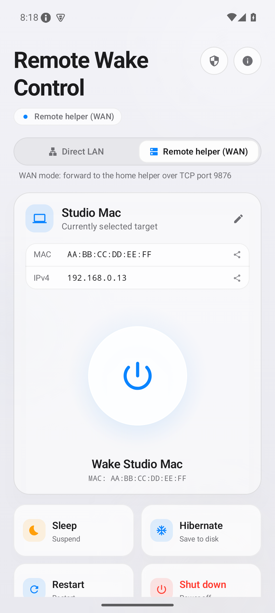
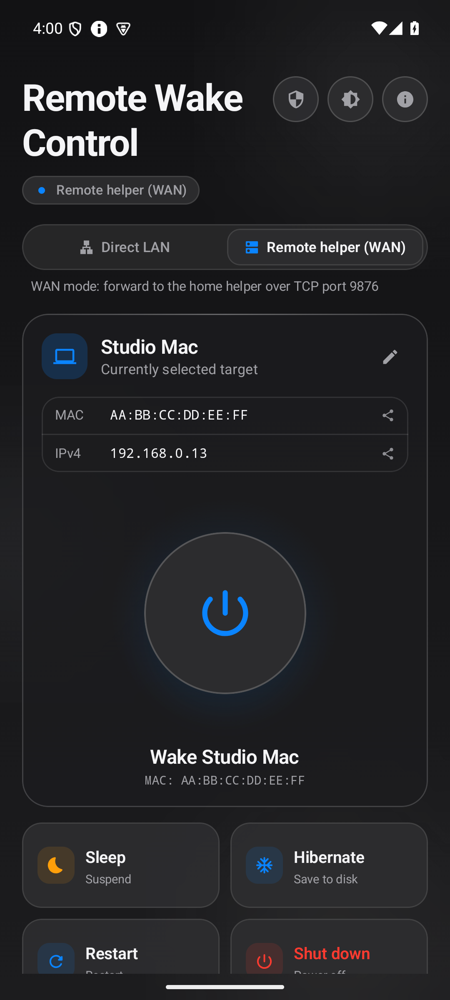
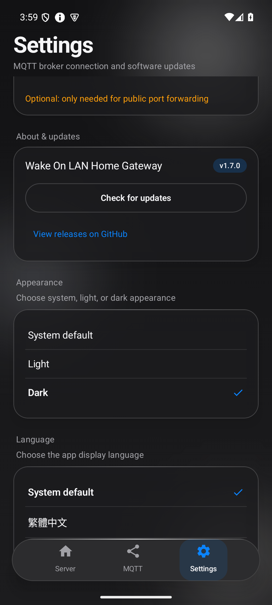
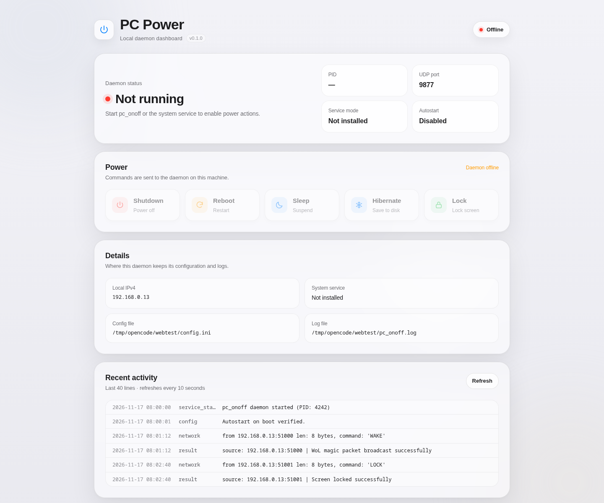
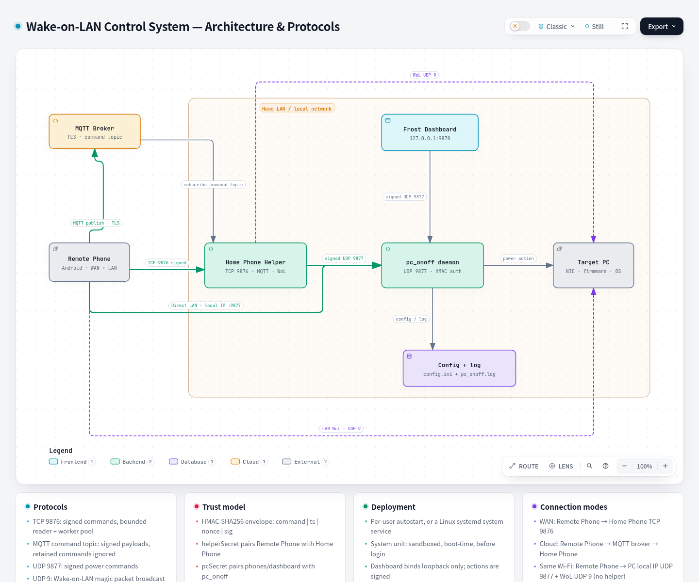

# Wake-on-LAN & Remote PC Power Control

[繁體中文說明 (Traditional Chinese)](README_zh.md)

[](https://pinchiu.github.io/wake-on-lan-for-android/)
[](https://pinchiu.github.io/wake-on-lan-for-android/archify-explainer.html)
[](#2-home-assistant--google-home-free-no-nabu-casa)
[](https://github.com/pinchiu/wake-on-lan-for-android/releases/latest)

Cross-platform remote power control for Windows, Linux, and macOS computers — supporting **Wake-on-LAN**, **Shutdown**, **Reboot**, **Sleep**, **Hibernate**, and **Lock Screen** over local Wi-Fi, Tailscale, Home Assistant / Google Home, or an Android Home Phone gateway.

**Contents:** [Choose Your Setup](#choose-your-setup) · [Features](#features) · [Screenshots](#screenshots) · [Architecture & Docs](#architecture--documentation) · [Downloads](#downloads) · [Setup Guide](#setup-guide) · [Security Model](#security-model) · [Troubleshooting](#troubleshooting)

---

## Choose Your Setup

Install the lightweight Rust daemon (`pc_onoff`) on your target PC, then pick whichever control path fits your home network:

| Control Path | What You Need | Remote Access | Best For |
| :--- | :--- | :--- | :--- |
| **Home Assistant + Google Home** | Existing Home Assistant + free Tailscale Funnel (or Nabu Casa / Cloudflare Tunnel) | Voice & Google Home app from anywhere | Hands-free voice control (`turn on/off`, `reboot`, `sleep`, `hibernate`, `lock`) with zero subscription fee |
| **Android Home Phone + Remote Phone** | A spare Android phone on home Wi-Fi + your daily Android phone | Direct TCP (Tailscale / IPv6) or MQTT Cloud | Environments without a Home Assistant server |
| **Local Wi-Fi Direct** | Your daily Android phone only | Home Wi-Fi (`Local LAN Mode`) | Simplest setup when you only need control at home |

---

## Features

- **PC Power Daemon (`pc_onoff`)**: Standalone, zero-dependency Rust binary for Windows, Linux, and Apple macOS. Auto-registers user autostart (Windows `HKCU Run`, Linux `systemd --user` / XDG, macOS `LaunchAgent`), supports a Linux boot-before-login system service (`sudo pc_onoff --install-system`), rotates `pc_onoff.log` at 5 MB, and includes an optional local Web dashboard (`pc_onoff --web-ui`).
- **Home Assistant & Google Home (`custom_components/pc_onoff`)**: Zero-dependency HACS custom integration exposing each PC as a primary on/off switch, six action buttons, and a connectivity sensor. Includes a 25-second optimistic state hold during BIOS boot, a one-command free Google Home setup script (`scripts/setup-ha-google-home.sh`), and a reusable AI agent skill.
- **Android Apps (Home Phone & Remote Phone)**: Multi-device profiles, reliable TCP relay (port 9876) with immediate ACK feedback, MQTT cloud mode (no port forwarding), Local LAN direct mode, home-screen 1-tap widgets, Google Assistant / Gemini app shortcut (`wake_pc_shortcut`), and English / Traditional Chinese switching.
- **Security & Frost Interface**: Zero secrets needed on private LAN or Tailscale; automatic HMAC-SHA256 signing with timestamp and replay protection for public port-forwards. Both Android apps and the daemon web UI share the calm **Frost** design system with System / Light / Dark appearance ([`docs/frost-ui.md`](docs/frost-ui.md)).

---

## Screenshots

| Home Phone (Light) | Remote Phone (Light) | Remote Phone (Dark) | Appearance (Dark) | Local Dashboard |
| :---: | :---: | :---: | :---: | :---: |
|  |  |  |  |  |

---

## Architecture & Documentation



1. **Remote Phone -> Home Phone (TCP Direct)**: Connects over Tailscale or public IPv6/IPv4 on **TCP 9876** with two-way acknowledgment (`SUCCESS:` / `ERROR:`).
2. **Remote Phone -> Home Phone (MQTT Cloud)**: Publishes and subscribes through an MQTT broker to traverse strict NATs without port forwarding.
3. **Home Phone -> Target PC (LAN Relay)**: Broadcasts Wake-on-LAN magic packets on **UDP 9** (`255.255.255.255`) and sends power actions on **UDP 9877**.
4. **Remote Phone -> Target PC (Local LAN Mode)**: Sends UDP 9 / UDP 9877 packets directly when on the same Wi-Fi network.
5. **Google Home -> Home Assistant -> Target PC**: Routes voice commands to `custom_components/pc_onoff`, which emits the exact same **UDP 9** and **UDP 9877** packets directly on the LAN.

### Interactive Portals & Reference Docs

| Resource | Link | Summary |
| :--- | :--- | :--- |
| **Architecture Wiki** | [pinchiu.github.io/wake-on-lan-for-android/](https://pinchiu.github.io/wake-on-lan-for-android/) | 3-pane interactive wiki, embedded diagrams, English / Traditional Chinese switching, search, and line-level source links |
| **Archify Interactive Explainer** | [archify-explainer.html](https://pinchiu.github.io/wake-on-lan-for-android/archify-explainer.html) | 1-page visual walkthrough with 4 animated diagrams (Topology, 25s Hold Sequence, HMAC Trust Flow, Deep-Module Tree) |
| **Protocol & System Map** | [architecture.html](https://pinchiu.github.io/wake-on-lan-for-android/architecture.html) | Full-canvas interactive component and wire-protocol diagram ([PNG](docs/screenshots/architecture-frost.png)) |
| **Home Assistant Full Guide** | [`docs/home-assistant.md`](docs/home-assistant.md) | Complete bilingual reference for HACS, entities, status probing, Google Home routines, and troubleshooting |
| **AI Agent Setup Skill** | [`docs/skills/ha-google-home-pc-setup/SKILL.md`](docs/skills/ha-google-home-pc-setup/SKILL.md) | Reusable skill allowing an AI coding agent to automate the entire HA + Google Home setup |

<details>
<summary>Markdown Architecture Wiki Chapters (docs/wiki/)</summary>

- [`docs/wiki/Home.md`](docs/wiki/Home.md) — 1. System Overview & Gateway Topology
- [`docs/wiki/Architecture-and-Deep-Modules.md`](docs/wiki/Architecture-and-Deep-Modules.md) — 2. Architecture & Deep Modules
- [`docs/wiki/Wire-Protocols-and-Security.md`](docs/wiki/Wire-Protocols-and-Security.md) — 3. Wire Protocols & Security
- [`docs/wiki/Subsystems-File-Map.md`](docs/wiki/Subsystems-File-Map.md) — 4. Subsystems File Map

</details>

---

## Downloads

All pre-built binaries, APKs, and the Home Assistant archive are published on the [GitHub Releases page](https://github.com/pinchiu/wake-on-lan-for-android/releases/latest):

| Component | Platform | Artifact | Role |
| :--- | :--- | :--- | :--- |
| **PC Daemon (`pc_onoff`)** | Windows (x64) | `pc_onoff-windows-x86_64.exe` (or `.zip`) | Background UDP 9877 power daemon |
| **PC Daemon (`pc_onoff`)** | Linux (x64) | `pc_onoff-linux-x86_64.AppImage` / binary / `.tar.gz` | Portable daemon + optional systemd service |
| **PC Daemon (`pc_onoff`)** | macOS (Universal) | `pc_onoff-macos-universal.zip` / `.tar.gz` | Native Apple Silicon & Intel binary |
| **Home Assistant** | HA 2024.1+ | `pc_onoff-home-assistant.zip` (or HACS) | Zero-dependency `custom_components/pc_onoff/` |
| **Android Gateway** | Android | `wakeonlan-home-phone.apk` | Spare phone stationed on home Wi-Fi |
| **Android Remote** | Android | `wakeonwan-remote-phone.apk` | Daily phone for sending commands anywhere |

---

## Setup Guide

### 1. Install the PC Daemon (`pc_onoff`)

Download the binary for your OS from [Releases](https://github.com/pinchiu/wake-on-lan-for-android/releases/latest):

- **Windows**: Double-click `pc_onoff-windows-x86_64.exe`. It runs silently on UDP 9877, registers `HKCU\...\Run` autostart (no admin needed), and logs to `pc_onoff.log`. To open the firewall automatically, run once as Administrator: `pc_onoff.exe --firewall`.
- **Linux**:
  ```bash
  chmod +x pc_onoff-linux-x86_64.AppImage
  ./pc_onoff-linux-x86_64.AppImage
  ```
  This registers a `systemd --user` service and XDG autostart. To accept commands **before anyone logs in** (e.g. at the login screen after a remote wake), install the boot-time system service once:
  ```bash
  sudo ./pc_onoff-linux-x86_64.AppImage --install-system
  ```
  (Installs `/usr/local/bin/pc_onoff` and `/etc/systemd/system/pc_onoff.service`; remove with `sudo pc_onoff --uninstall-system`.)
- **macOS**: Extract `pc_onoff-macos-universal.zip` and run:
  ```bash
  chmod +x pc_onoff
  ./pc_onoff
  ```
  Automatically installs a user LaunchAgent (`~/Library/LaunchAgents/com.wakeonlan.pc_onoff.plist`) without root.

<details>
<summary>Daemon CLI Reference & Local Frost Web Dashboard</summary>

```bash
pc_onoff --status                # Runtime, IP, port, command secret, autostart state
pc_onoff --log                   # View the latest 25 log lines
pc_onoff --stop                  # Stop the running background daemon
pc_onoff --install               # Enable user autostart
pc_onoff --uninstall             # Disable user autostart
sudo pc_onoff --install-system   # Linux: boot-time system service (works before login)
sudo pc_onoff --uninstall-system # Linux: remove the system service
pc_onoff --web-ui                # Local Frost dashboard at http://127.0.0.1:9878
pc_onoff --help                  # Show usage
```

`pc_onoff --web-ui` runs in the foreground on loopback only, displays daemon status and recent logs, and sends signed UDP 9877 commands with confirmation prompts for shutdown and reboot.

</details>

---

### 2. Home Assistant & Google Home (Free, No Nabu Casa)

Home Assistant can act as your LAN gateway and bridge directly to Google Home — supporting **Turn On**, **Turn Off**, **Reboot**, **Sleep**, **Hibernate**, and **Lock Screen** without a paid Nabu Casa subscription or a Google Service Account JSON.

[](https://my.home-assistant.io/redirect/hacs_repository/?owner=pinchiu&repository=wake-on-lan-for-android&category=integration)

#### Connection Options

| Option | Cost | Requirements | Notes |
| :--- | :--- | :--- | :--- |
| **Tailscale Funnel + Google Home Developer Console** | **Free** | Tailscale on HA host | No custom domain, no port forwarding, **no Service Account JSON** (`report_state: false`) |
| **Cloudflare Tunnel + Google Home Developer Console** | Free (needs domain) | Cloudflare account + domain | Pass `--no-funnel --public-url https://ha.example.com` to the helper script |
| **Nabu Casa (Home Assistant Cloud)** | Paid subscription | Nabu Casa account | Official cloud; expose `switch.<pc>` in **Settings -> Voice Assistants -> Expose** |

#### Fastest Path: One-Command Script or AI Agent Skill

Run the bundled setup script on your Home Assistant host (use `--dry-run` to preview first):

```bash
./scripts/setup-ha-google-home.sh \
  --ha-config ~/homeassistant/config \
  --project-id <GOOGLE_HOME_PROJECT_ID> \
  --entity-slug gaming_pc \
  --pc-name "Gaming PC"
```

What the script automates:
1. Installs `custom_components/pc_onoff/` into your HA config directory.
2. Configures reverse-proxy trust (automatically patches `.storage/http` on **HA 2026+** where `configuration.yaml` `http:` is ignored, or appends `http:` on older HA).
3. Inspects `tailscale serve status`, picks the first free HTTPS port (`443 -> 8443 -> 10000`) without touching existing services, and enables Tailscale Funnel.
4. Appends the 4 Google Home action scripts (`reboot`, `sleep`, `hibernate`, `lock`) to `scripts.yaml` and adds the zero-JSON `google_assistant:` block to `configuration.yaml`.
5. Validates config, restarts HA, tests public endpoints (`GET /` -> `200`, `GET /auth/authorize` -> `200`, `POST /api/google_assistant` -> `401`), and prints your exact Developer Console copy-paste table.

> [!NOTE]
> Prefer letting an AI assistant run this for you? Give your coding agent [`docs/skills/ha-google-home-pc-setup/SKILL.md`](docs/skills/ha-google-home-pc-setup/SKILL.md).

<details>
<summary>Common Helper Script Flags</summary>

| Flag | Purpose |
| :--- | :--- |
| `--https-port 8443` | Force port 8443 (useful if 443 is already taken; otherwise auto-selected from `443`, `8443`, `10000`) |
| `--no-funnel --public-url https://ha.example.com` | Reuse Cloudflare Tunnel or an existing HTTPS reverse proxy |
| `--container ""` | Home Assistant Core without Docker (default container name: `homeassistant`) |
| `--dry-run` | Print every planned file edit and command without modifying anything |

</details>

#### Manual Step-by-Step Walkthrough

##### Step A — Install the Integration & Add Your PC in Home Assistant

1. **Install** via one of three methods, then restart Home Assistant:
   - **HACS (Recommended)**: **HACS -> ⋮ -> Custom repositories** -> add `https://github.com/pinchiu/wake-on-lan-for-android` (Category: `Integration`) -> download **Wake-on-LAN & PC Power (pc_onoff)**.
   - **Release ZIP**:
     ```bash
     curl -L -o /tmp/pc_onoff-home-assistant.zip \
       https://github.com/pinchiu/wake-on-lan-for-android/releases/latest/download/pc_onoff-home-assistant.zip
     unzip -o /tmp/pc_onoff-home-assistant.zip 'custom_components/*' -d /config
     ```
   - **Manual copy**: `cp -r custom_components/pc_onoff /config/custom_components/pc_onoff`
2. **Add Target PC**: Go to **Settings -> Devices & Services -> + Add Integration -> Wake-on-LAN & PC Power (pc_onoff)**:

| Field | Example | Notes |
| :--- | :--- | :--- |
| **Name** | `Gaming PC` | Google Home voice name (immutable after setup) |
| **MAC Address** | `AA:BB:CC:DD:EE:FF` | Wired NIC receiving Wake-on-LAN |
| **Host IP** | `192.168.1.50` | Static LAN IP (Tailscale or public IP also works) |
| **PC Secret** | *(blank)* | Leave blank on private LAN / Tailscale; required only for public IP |
| **Turn-off Action** | `shutdown` | `shutdown`, `sleep`, or `hibernate` |
| **Status Probe** | `ping` | `ping` (ICMP), `tcp` (single port, default `445`), or `none` (optimistic only) |

> [!WARNING]
> **Docker users:** Home Assistant must use `network_mode: host` so UDP 9 Wake-on-LAN broadcasts reach the PC's NIC.

**How PC status checking works:** Home Assistant polls every `scan_interval` seconds (default `30s`) using `ping` (ICMP echo), `tcp` (TCP connect to `probe_port`, where even a refused connection counts as online), or `none`. After a wake or power-off command, the switch holds the requested state for **25 seconds** (`OPTIMISTIC_HOLD_SECONDS = 25.0`) and reconciles at **+26s**, preventing Google Home from bouncing back to OFF while the BIOS is booting.

##### Step B — Expose Home Assistant via Tailscale Funnel & Fix HA 2026+ Reverse Proxy

1. **Avoid Port 443 Conflicts**: Tailscale Funnel supports ports **443, 8443, and 10000**. Run `tailscale serve status` first; if port 443 is already used by another service (such as CouchDB, Immich, or Vaultwarden), bind Home Assistant to **8443**:
   ```bash
   sudo tailscale funnel --bg --https=8443 http://127.0.0.1:8123
   ```
   Your public URL becomes `https://<host>.<tailnet>.ts.net:8443`.
2. **Trust Reverse Proxy (HA 2026+ Gotcha)**: In Home Assistant **2026+**, once `<ha-config>/.storage/http` has `"yaml_migration_done": true`, any `http:` section in `configuration.yaml` is **ignored** and Funnel requests return **HTTP 400** (`your HTTP integration is not set-up for reverse proxies`). Stop HA, add the following inside `.storage/http` under `data.stable`, and restart HA:
   ```json
   "use_x_forwarded_for": true,
   "trusted_proxies": ["127.0.0.1/32", "::1/128", "172.16.0.0/12"]
   ```
   *(On older HA versions without `.storage/http` migration, put those two keys under `http:` in `configuration.yaml`.)*

##### Step C — Expose Switch + 4 Extra Action Scripts (Reboot, Sleep, Hibernate, Lock)

Google Home maps only ON/OFF to a switch. To trigger **Reboot**, **Sleep**, **Hibernate**, and **Lock Screen** from Google Home, add four scripts to `scripts.yaml` and expose both `switch` and `script` in `configuration.yaml` (`report_state: false` requires **no Service Account JSON**):

```yaml
# scripts.yaml
gaming_pc_reboot:
  alias: "Reboot Gaming PC"
  sequence:
    - action: button.press
      target:
        entity_id: button.gaming_pc_reboot

gaming_pc_sleep:
  alias: "Sleep Gaming PC"
  sequence:
    - action: button.press
      target:
        entity_id: button.gaming_pc_sleep

gaming_pc_hibernate:
  alias: "Hibernate Gaming PC"
  sequence:
    - action: button.press
      target:
        entity_id: button.gaming_pc_hibernate

gaming_pc_lock:
  alias: "Lock Gaming PC"
  sequence:
    - action: button.press
      target:
        entity_id: button.gaming_pc_lock_screen
```

```yaml
# configuration.yaml
google_assistant:
  project_id: <GOOGLE_HOME_PROJECT_ID>
  report_state: false
  expose_by_default: false
  exposed_domains:
    - switch
    - script
  entity_config:
    switch.gaming_pc:
      name: "Gaming PC"
      expose: true
    script.gaming_pc_reboot:
      name: "Reboot Gaming PC"
      expose: true
    script.gaming_pc_sleep:
      name: "Sleep Gaming PC"
      expose: true
    script.gaming_pc_hibernate:
      name: "Hibernate Gaming PC"
      expose: true
    script.gaming_pc_lock:
      name: "Lock Gaming PC"
      expose: true
```

Restart Home Assistant and confirm your public endpoints return **200 / 200 / 401**:
```bash
curl -s -o /dev/null -w "GET / -> %{http_code}\n" <PUBLIC_URL>/
curl -s -o /dev/null -w "GET /auth/authorize -> %{http_code}\n" <PUBLIC_URL>/auth/authorize
curl -s -o /dev/null -w "POST /api/google_assistant -> %{http_code}\n" -X POST <PUBLIC_URL>/api/google_assistant
```

##### Step D — Configure Google Home Developer Console & Link Your Phone

1. Open `https://console.home.google.com/projects/<PROJECT_ID>` -> **Cloud-to-cloud -> Add / Develop** and paste these exact values:

| Field | Exact Value |
| :--- | :--- |
| **Development / Integration name** | `<PC Name>` (e.g. `Gaming PC`) |
| **Device types** | `Switch` + `Scene` |
| **App icon** | Any square PNG >= 144x144 (required to Save) |
| **Cloud fulfillment URL** | `<PUBLIC_URL>/api/google_assistant` |
| **OAuth Client ID** | `https://oauth-redirect.googleusercontent.com/r/<PROJECT_ID>` |
| **OAuth Client Secret** | Any non-empty string (e.g. `ha-wol-secret-2026`) |
| **Authorization URL** | `<PUBLIC_URL>/auth/authorize` |
| **Token URL** | `<PUBLIC_URL>/auth/token` |

> [!WARNING]
> - Paste URLs with **no leading or trailing spaces** — Google rejects leading spaces with *Please enter a valid https link*.
> - Do **not** create an `*.apps.googleusercontent.com` OAuth client (that is for the outbound Google Assistant SDK). Use `https://oauth-redirect.googleusercontent.com/r/<PROJECT_ID>` exactly.
> - **No Service Account JSON is needed** when `report_state: false`.

2. Click **Save -> Test -> Start testing** (do not submit for public review).
3. On your phone (signed into the **same Google account**): force-close and reopen the **Google Home** app -> **Devices -> + Add -> Works with Google Home** -> select **`[test] <PC Name>`** -> log into Home Assistant.
4. **Syncing new action scripts later**: Because `report_state: false` does not push updates automatically, whenever you add scripts go to **Settings -> Works with Google -> `[test] <PC Name>` -> Reconnect account** (or **Check for new devices**).

Voice commands once linked:
- *"Hey Google, turn on Gaming PC"* / *"Hey Google, turn off Gaming PC"*
- *"Hey Google, activate Reboot Gaming PC"* (or bind `Reboot` / `Sleep` / `Hibernate` / `Lock` to custom phrases in **Google Home -> Automations / Routines**)

---

### 3. Android Apps (Home Phone Gateway & Remote Phone)

1. Install `wakeonlan-home-phone.apk` on your spare Home Phone (connected to home Wi-Fi) and `wakeonwan-remote-phone.apk` on your Remote Phone (enable "Install from unknown sources" if prompted).
2. Choose a transport mode:
   - **Direct TCP (Recommended for Tailscale / IPv6)**: Open the Home Phone app and tap **Start Service** (shows its TCP 9876 address). On the Remote Phone, add your PC profile (MAC + LAN IPv4), enter the Home Phone address, and send `WAKE`, `SHUTDOWN`, `REBOOT`, `SLEEP`, `HIBERNATE`, or `LOCK`.
   - **MQTT Cloud**: Enter the same broker Host, Port, Username, Password, and Topic in both apps. Commands use `WAKE:<MAC>`, `SHUTDOWN:<IP>`, `REBOOT:<IP>`, `SLEEP:<IP>`, `HIBERNATE:<IP>`, `LOCK:<IP>`.
   - **Local LAN Mode**: When on home Wi-Fi, enable **Local LAN Mode** on the Remote Phone to talk directly to your PC without the Home Phone.

---

## Security Model

The recommended network setup is **Tailscale** or private home Wi-Fi. Commands arriving from private or Tailscale addresses require **no secret**:

- **IPv4**: `10/8`, `172.16/12`, `192.168/16`, `169.254/16`, `127/8`, `100.64/10` (Tailscale)
- **IPv6**: `::1`, `fe80::/10`, `fc00::/7` (including Tailscale `fd7a:115c:a1e0::/48`)

Only **public IPv6/IPv4 port-forwards** require an HMAC-SHA256 secret. Paste it once; all public commands are signed automatically with a +/-5 minute timestamp window (keep NTP enabled) and a 10-minute nonce replay cache:

```text
SHUTDOWN:192.168.1.10|ts=1700000000|nonce=0011223344556677|sig=<hmac-sha256-hex>
```

| Secret | Where to Get It | Where to Paste It |
| :--- | :--- | :--- |
| **PC Secret** | `pc_onoff --status` -> `Command Secret: ...` | Target PC profile -> PC Secret (global Settings / shield value is fallback only) |
| **Helper Secret** | Home Phone -> Settings -> Security -> Helper Secret (Generate) | Remote Phone -> Shield icon -> Helper Secret |

MQTT relies on broker TLS, credentials, and topic ACLs rather than HMAC. Never expose UDP 9877 or TCP 9876 directly to the internet without HMAC authentication.

---

## Troubleshooting

| Symptom | Likely Cause | Fix |
| :--- | :--- | :--- |
| **WoL does not wake PC** | BIOS/NIC WoL disabled, Fast Startup on, or Docker bridge network | Enable Wake-on-LAN / PCIe Power On in BIOS; enable magic-packet wake in Windows Device Manager and disable Fast Startup; run HA Docker with `network_mode: host` |
| **Power commands unresponsive** | Daemon stopped or UDP 9877 blocked | Run `pc_onoff --status`; open UDP 9877 (`pc_onoff.exe --firewall` as Admin on Windows, `sudo ufw allow 9877/udp` on Linux, allow in macOS Firewall) |
| **Tailscale Funnel returns HTTP 400** | HA 2026+ ignores `http:` in `configuration.yaml` after storage migration | Stop HA and patch `.storage/http` -> `data.stable` with `use_x_forwarded_for: true` and `trusted_proxies` (or run `scripts/setup-ha-google-home.sh`) |
| **Developer Console rejects HTTPS URL** | Leading/trailing space or wrong OAuth Client ID | Trim all spaces; ensure OAuth Client ID is `https://oauth-redirect.googleusercontent.com/r/<PROJECT_ID>` |
| **New Reboot / Sleep / Lock scenes missing in Google Home** | `report_state: false` does not auto-sync new entities | In phone Google Home app: **Settings -> Works with Google -> `[test] <Name>` -> Reconnect account** |
