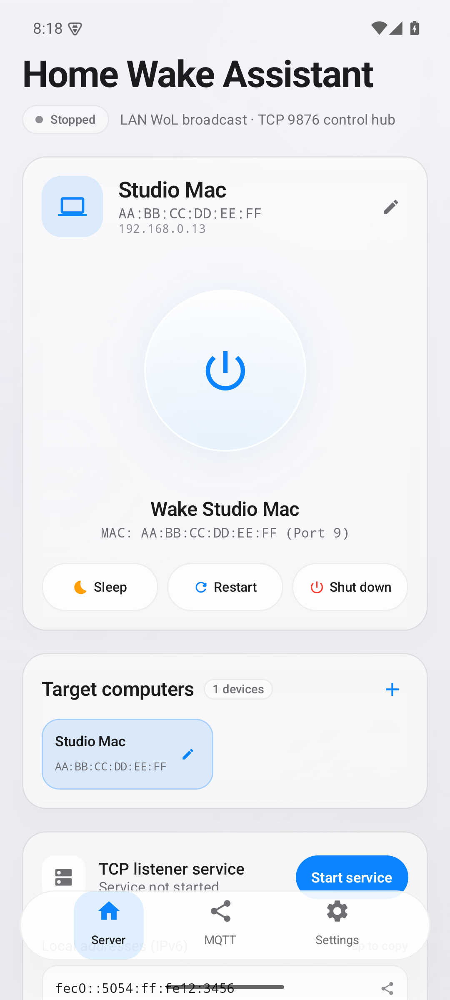

# Wake-on-LAN Home Phone Remote Control
[中文說明 (Traditional Chinese)](README_zh.md)

[](https://pinchiu.github.io/wake-on-lan-for-android/)
[](https://pinchiu.github.io/wake-on-lan-for-android/archify-explainer.html)
[](#4-home-assistant--google-home-optional)
[](https://github.com/pinchiu/wake-on-lan-for-android/releases/latest)

> [!TIP]
> **Interactive Architecture & Documentation Portal**
>
> | Portal | Open Online | Description |
> | :--- | :--- | :--- |
> | 🖥️ **Architecture Wiki (`opencode.ai` Terminal UI)** | [**pinchiu.github.io/wake-on-lan-for-android/**](https://pinchiu.github.io/wake-on-lan-for-android/) | 3-pane interactive architecture wiki (`#0c0c0c` terminal theme), embedded Archify interactive diagrams, full English / 繁體中文 switching, instant search, and line-level source links |
> | ✨ **Archify Interactive Explainer** | [**.../archify-explainer.html**](https://pinchiu.github.io/wake-on-lan-for-android/archify-explainer.html) | Validated 1-page interactive explainer with 4 animated diagrams (Topology, 25s Google Home Hold Sequence, HMAC Trust Workflow, Deep-Module Tree), step-by-step walkthroughs, and PNG/SVG/PDF export |
> | 🗺️ **Protocol & System Map** | [**.../architecture.html**](https://pinchiu.github.io/wake-on-lan-for-android/architecture.html) | Full-canvas interactive component and wire-protocol map |
> | 🏠 **Home Assistant & Google Home Guide** | [**§4 Install Guide**](#4-home-assistant--google-home-optional) · [`docs/home-assistant.md`](docs/home-assistant.md) | Bilingual HACS setup, config fields, 25s optimistic hold, and Google Home voice control guide |
>
> **Markdown Architecture Wiki Chapters** (docs/wiki/):
> - [`docs/wiki/Home.md`](docs/wiki/Home.md) — 1. System Overview & Gateway Topology
> - [`docs/wiki/Architecture-and-Deep-Modules.md`](docs/wiki/Architecture-and-Deep-Modules.md) — 2. Architecture & Deep Modules
> - [`docs/wiki/Wire-Protocols-and-Security.md`](docs/wiki/Wire-Protocols-and-Security.md) — 3. Wire Protocols & Security
> - [`docs/wiki/Subsystems-File-Map.md`](docs/wiki/Subsystems-File-Map.md) — 4. Subsystems File Map

A complete cross-platform remote control system that turns an Android phone into a home gateway to perform Wake-on-LAN (WoL), shutdown, reboot, sleep, hibernate, and screen lock operations on your computers over mobile data, internet, or local Wi-Fi.

## Features
- **Wake-on-LAN**: Remotely wake up your computer using local UDP broadcast (LAN) or over the internet via TCP or MQTT.
- **Remote Power & Session Control**: Remotely trigger Shutdown, Reboot, Sleep, Hibernate, and Screen Lock.
- **Reliable Phone-to-Phone TCP Connection**: Connect directly from the Remote Phone to the Home Phone over IPv6 or IPv4 on TCP port 9876 with guaranteed delivery and immediate status feedback.
- **Local LAN Mode**: When connected to your home Wi-Fi, the Remote Phone can send WoL packets (UDP port 9) and power commands (UDP port 9877) directly without relaying through the helper phone.
- **MQTT Cloud Mode**: Connect to any MQTT broker (e.g. HiveMQ, EMQX, Adafruit IO) to control your PC without needing a public IP or router port forwarding.
- **Multi-Device Profiles**: Manage multiple target computers (name, MAC address, LAN IP) on the Remote Phone and switch between them effortlessly.
- **Dual Home Screen Widgets**:
  - *Home Phone Widget*: 1-tap local Wake-on-LAN broadcast to wake the default PC.
  - *Remote Phone Widget*: 1-tap remote wake targeting the currently selected profile.
- **Voice Assistant Integration**: Hands-free voice trigger via Google Assistant / Gemini routines using the static app shortcut (`wake_pc_shortcut`).
- **Home Assistant & Google Home Integration**: A zero-dependency Home Assistant custom integration (`custom_components/pc_onoff/`, installable through HACS) exposes each PC as a Google Home on/off switch, six action buttons and a connectivity sensor — no YAML, no extra PyPI packages. See [`docs/home-assistant.md`](docs/home-assistant.md).
- **Bilingual Interface**: Seamlessly switch between English and Traditional Chinese in the app settings.
- **Command Security**: Private LAN and Tailscale require no secret; public IPv6/IPv4 port-forwards use HMAC-SHA256 envelopes with a timestamp and replay guard; MQTT relies on broker TLS, credentials, and topic ACLs.
- **Frost Interface**: Both Android apps share a calm light-grey glass design — translucent cards, hairline borders, system typography and one iOS-blue accent — with **System / Light / Dark** appearance. The Rust daemon adds an optional local dashboard with the same design language.
- **Cross-Platform PC Daemon (`pc_onoff`)**: High-performance, zero-dependency standalone daemon written in Rust for Windows, Linux, and Apple macOS.
  - Automatic zero-admin autostart (Windows Registry `HKCU Run`, Linux `systemd --user` / XDG Autostart, macOS `LaunchAgent`).
  - Optional Linux system-wide service (`sudo pc_onoff --install-system`) that works before anyone logs in.
  - Local Web dashboard (`pc_onoff --web-ui`) for status, logs and power actions.
  - Automatic 5 MB log rotation (`pc_onoff.log`).
  - Rich command-line management interface.

## Downloads

Download the latest pre-built releases from the [GitHub Releases page](https://github.com/pinchiu/wake-on-lan-for-android/releases):

### Android Apps
- `wakeonlan-home-phone.apk`: Install on your spare Android phone stationed at home and connected to your home Wi-Fi. This acts as the gateway/helper.
- `wakeonwan-remote-phone.apk`: Install on the phone you carry with you to send control commands anywhere.

### Computer Power Control Daemon (`pc_onoff`)
- **Windows**: `pc_onoff-windows-x86_64.exe` (or `.zip`) — 64-bit standalone executable, runs immediately with zero dependencies.
- **Linux**: `pc_onoff-linux-x86_64.AppImage` (or standalone binary `pc_onoff-linux-x86_64` / `.tar.gz`) — portable AppImage running on any modern Linux distribution.
- **Apple macOS**: `pc_onoff-macos-universal.zip` (or `.tar.gz` / binary `pc_onoff-macos-universal`) — Universal Binary natively supporting Apple Silicon (M1/M2/M3/M4) and Intel Macs.

### Home Assistant Custom Integration (`pc_onoff`)
- `custom_components/pc_onoff/` — Home Assistant 2024.1+ custom integration with zero external PyPI dependencies. Add `https://github.com/pinchiu/wake-on-lan-for-android` as a **HACS custom repository** (category: Integration) or copy the folder into `/config/custom_components/`. Setup, entities and Google Home voice control: [`docs/home-assistant.md`](docs/home-assistant.md).

## Command Security (LAN/Tailscale first)

The recommended setup is **Tailscale** (or plain home Wi-Fi). Commands from private and
Tailscale addresses need **no secret at all**:

- IPv4 `10/8`, `172.16/12`, `192.168/16`, `169.254/16`, `127/8`, `100.64/10` (Tailscale).
- IPv6 `::1`, `fe80::/10`, `fc00::/7` (including Tailscale `fd7a:115c:a1e0::/48`).

Public IPv6/IPv4 is the only path that needs a secret. Paste the daemon/helper secret **once**
into the apps; every public command is then signed automatically. You never re-enter or
re-verify it per connection.

MQTT does **not** use HMAC. It relies on the broker's TLS, username/password and topic ACLs,
because the publisher IP is not visible to the subscriber.

```text
SHUTDOWN:192.168.1.10|ts=1700000000|nonce=0011223344556677|sig=<hmac-sha256-hex>
```

For a public port-forward, copy the values once. If each PC daemon has a different secret, set it on that computer's profile; the global value is used only when a profile leaves it blank.

| Secret | Where to get it | Where to paste it |
| :--- | :--- | :--- |
| **PC secret** | `pc_onoff --status` → `Command Secret: ...` | Per computer: add/edit target → PC secret. The Settings / shield value is only the fallback for targets that leave it blank. |
| **Helper secret** | Home Phone → Settings → Security → Helper secret (Generate) | Remote Phone → shield icon → Helper secret |

Timestamps must be within ±5 minutes (keep NTP enabled); nonces are remembered for 10 minutes.
Never expose UDP 9877 or TCP 9876 to the internet without the HMAC secret. Tailscale is strongly
preferred over port forwarding.

## Frost Interface

Both Android apps and the Rust daemon's optional dashboard use the same **Frost** design system:

- Warm neutral greys (`#F2F2F7` → `#E9E9EF`) instead of pure black or neon.
- Translucent frosted cards with hairline borders, 22–28 dp radii and soft ambient shadows.
- System (SF-like) typography, sentence-case labels and generous spacing.
- A single iOS-blue (`#0A84FF`) accent plus iOS green / orange / red for status only.
- Calm 180–320 ms motion; no HUD chrome, scan lines or glow.

The Android apps adapt automatically and stay readable in both layouts. The dashboard also honours
`prefers-color-scheme` (light frosted grey / dark graphite glass). See
[`docs/frost-ui.md`](docs/frost-ui.md) for tokens and component rules.

## Screenshots

| Home Phone (light) | Remote Phone (light) | Remote Phone (dark) | Appearance (dark) | Local dashboard |
| :---: | :---: | :---: | :---: | :---: |
|  |  |  |  |  |

## System Architecture & Protocols

**[▶ Open the interactive architecture & protocols diagram](https://pinchiu.github.io/wake-on-lan-for-android/architecture.html)** · [PNG](docs/screenshots/architecture-frost.png)


1. **Remote Phone -> Home Phone (WAN TCP Direct)**:
   - Connects via **TCP (Port 9876)** over public IPv6 / IPv4.
   - Guaranteed two-way acknowledgment (returns `SUCCESS: ...` or `ERROR: ...`).
2. **Remote Phone -> Home Phone (MQTT Cloud Mode)**:
   - Subscribes and publishes via an external MQTT broker.
   - Traverses strict NATs and firewalls without port forwarding.
3. **Home Phone -> Target Computer (LAN Relay)**:
   - WoL Wake: Broadcasts Magic Packet via **UDP (Port 9)** to `255.255.255.255`.
   - PC Power Commands: Sends UDP datagram via **UDP (Port 9877)** to the PC's local IP.
4. **Remote Phone -> Target Computer (Local LAN Mode)**:
   - When on the same Wi-Fi network, commands are sent directly to the PC / subnet.
5. **Google Home -> Home Assistant (`custom_components/pc_onoff`)**:
   - Google Home routes *“turn on / turn off `<PC name>`”* to Home Assistant.
   - Home Assistant sends the same **UDP (Port 9)** magic packet and **UDP (Port 9877)** power commands directly to the PC — an optional, zero-dependency alternative to the Android Home Phone gateway.

## Setup & Getting Started

### 1. Computer Power Control Daemon (`pc_onoff`)

Download the binary for your operating system from [Releases](https://github.com/pinchiu/wake-on-lan-for-android/releases).

#### Running on Windows
Double-click `pc_onoff-windows-x86_64.exe` (or `pc_onoff.exe`).
- Runs silently in the background listening on UDP 9877 without console window popups.
- Automatically registers Windows autostart (`HKCU\Software\Microsoft\Windows\CurrentVersion\Run`, no admin required).
- Automatically writes event logs to `pc_onoff.log`.
- To allow firewall access automatically, run as administrator: `pc_onoff.exe --firewall`.

#### Running on Linux
- **AppImage (Recommended)**:
  ```bash
  chmod +x pc_onoff-linux-x86_64.AppImage
  ./pc_onoff-linux-x86_64.AppImage
  ```
- **Standalone Binary**:
  ```bash
  chmod +x pc_onoff-linux-x86_64
  ./pc_onoff-linux-x86_64
  ```
- Automatically registers a `systemd --user` service and an XDG autostart entry for persistence across reboots.

#### Working before anyone logs in (Linux)
The default `systemd --user` / XDG autostart only starts **after you log in**, so a freshly booted PC sitting at the login screen ignores shutdown/reboot commands. Install the system-wide service once to fix this:
```bash
sudo ./pc_onoff-linux-x86_64.AppImage --install-system   # or: sudo ./pc_onoff --install-system
```
This copies the binary to `/usr/local/bin/pc_onoff`, installs `/etc/systemd/system/pc_onoff.service` (enabled for `multi-user.target`, runs as root), stores config/logs in `/var/lib/pc_onoff/`, and removes the per-user autostart so the two never compete for UDP 9877. Remove it with `sudo pc_onoff --uninstall-system`.

#### Running on Apple macOS
Download and extract `pc_onoff-macos-universal.zip`.
```bash
chmod +x pc_onoff
./pc_onoff
```
- Automatically installs and loads a user LaunchAgent at `~/Library/LaunchAgents/com.wakeonlan.pc_onoff.plist`.
- Runs automatically at login without root privileges.
- Safely executes power actions via AppleScript System Events (shutdown, restart), `pmset` (sleep, hibernate), and `CGSession` (lock screen).

#### Daemon CLI Commands
The `pc_onoff` executable provides built-in management options:
```bash
pc_onoff --status                # Runtime, IP, port, autostart and system-service state
pc_onoff --log                   # View the latest 25 log lines
pc_onoff --stop                  # Stop the running background daemon
pc_onoff --install               # Enable autostart on boot
pc_onoff --uninstall             # Disable autostart on boot
sudo pc_onoff --install-system   # Linux: boot-time system service (works before login)
sudo pc_onoff --uninstall-system # Linux: remove the system service
pc_onoff --web-ui                # Local Frost dashboard (http://127.0.0.1:9878)
pc_onoff --help                  # Show usage
```

#### Local Frost Dashboard (optional)
```bash
pc_onoff --web-ui
# Dashboard: http://127.0.0.1:9878
```
The dashboard runs as a separate foreground process (it does not start a second daemon), binds
loopback only, and shows daemon state, local IPs, autostart/system-service status and recent logs.
It sends the five power actions through the normal UDP 9877 protocol, signed with the daemon's
command secret, and asks for confirmation before shutdown/reboot. The page supports light and dark `prefers-color-scheme` and uses the same
Frost design system as the Android apps.

### 2. Android Apps Setup

1. Install `wakeonlan-home-phone.apk` on your Home Phone and `wakeonwan-remote-phone.apk` on your Remote Phone.
2. Enable "Install from unknown sources" if prompted by Android.

### 3. Usage Modes

#### A. Direct TCP Mode (Recommended for IPv6)
1. Open **Home Phone App** and tap **Start Service**. The app displays its listening IPv6 and IPv4 addresses on TCP 9876.
2. Open **Remote Phone App**:
   - Add your PC profile (Target MAC and LAN IPv4).
   - Enter the Home Phone's IPv6 address.
   - Tap **WAKE**, **SHUTDOWN**, **REBOOT**, **SLEEP**, **HIBERNATE**, or **LOCK**.
   - The status bar will show real-time confirmation from the Home Phone.

#### B. MQTT Mode
1. Configure your MQTT broker credentials (Host, Port, Username, Password, Topic) in both apps.
2. Send commands using standard syntax:
   - `WAKE:<MAC>`
   - `SHUTDOWN:<IP>`
   - `REBOOT:<IP>`
   - `SLEEP:<IP>`
   - `HIBERNATE:<IP>`
   - `LOCK:<IP>`

#### C. Local LAN Mode
1. When connected to the same Wi-Fi network as your computer, toggle **Local LAN Mode** on the Remote Phone.
2. Commands are sent directly to the local subnet / computer IP without going through the Home Phone.

### 4. Home Assistant & Google Home (Optional)

Home Assistant can replace — or complement — the Home Phone as the LAN gateway, adding native
Google Home voice control without any extra Python packages.

[](https://my.home-assistant.io/redirect/hacs_repository/?owner=pinchiu&repository=wake-on-lan-for-android&category=integration)

#### Step 1 — Install the Integration

**Option A — Install via HACS (Recommended)**

1. Open **HACS** in the Home Assistant sidebar.
2. Open the **⋮** menu (top-right) and choose **Custom repositories**.
3. Enter `https://github.com/pinchiu/wake-on-lan-for-android`, choose Category **`Integration`**, and click **Add**.
4. Search HACS for **Wake-on-LAN & PC Power (pc_onoff)**.
5. Click **Download**.
6. **Restart Home Assistant** (**Settings → System → Restart**).

**Option B — Install via GitHub Release ZIP (`pc_onoff-home-assistant.zip`)**

Download the archive from the [latest release](https://github.com/pinchiu/wake-on-lan-for-android/releases/latest) and unzip it into your Home Assistant configuration directory:

```bash
cd /config
curl -L -o /tmp/pc_onoff-home-assistant.zip \
  https://github.com/pinchiu/wake-on-lan-for-android/releases/latest/download/pc_onoff-home-assistant.zip
unzip -o /tmp/pc_onoff-home-assistant.zip 'custom_components/*' -d /config
# → /config/custom_components/pc_onoff/
```

Restart Home Assistant after the files are in place.

**Option C — Manual Copy from Repository**

```bash
cp -r custom_components/pc_onoff /config/custom_components/pc_onoff
```

Restart Home Assistant. No `configuration.yaml` editing is required.

#### Step 2 — Add Target PC in Home Assistant UI

1. Go to **Settings → Devices & Services**.
2. Click **+ Add Integration**.
3. Search for and select **Wake-on-LAN & PC Power (pc_onoff)**.
4. Fill in the fields below and click **Submit**.

| Field | Example | Notes |
| :--- | :--- | :--- |
| **Name** | `Gaming PC` | Google Home voice name; immutable after setup. |
| **MAC Address** | `AA:BB:CC:DD:EE:FF` | Wired NIC that receives the Wake-on-LAN packet. |
| **Host IP** | `192.168.1.50` | Static LAN IP; Tailscale or a public IP also works. |
| **PC Secret** | *(blank)* | Leave blank on private LAN / Tailscale; required only for public IPs. |
| **Turn-off Action** | `shutdown` | `shutdown`, `sleep`, or `hibernate`. |
| **Status Probe** | `daemon` (UDP 9877 `ping → pong`), `tcp`, or `none` | How Home Assistant decides the PC is on; `none` keeps the switch optimistic-only. |

#### Step 3 — Expose to Google Home Voice Control

1. Go to **Settings → Voice Assistants → Expose** (Home Assistant Cloud / Nabu Casa or the Google Assistant integration must be configured first).
2. Expose **only** `switch.<pc_name>` (e.g. `switch.gaming_pc`).
3. In the Google Home app, say **“Hey Google, sync my devices”**.
4. Control the PC with **“Hey Google, turn on `<PC Name>`”** / **“Hey Google, turn off `<PC Name>`”**.

> [!TIP]
> The switch holds the requested state for 25 seconds (`OPTIMISTIC_HOLD_SECONDS = 25.0`) while the PC BIOS boots, so Google Home does not bounce back to off.

> [!WARNING]
> **Docker users:** run the Home Assistant container with `network_mode: host` so the UDP 9 Wake-on-LAN broadcast reaches the PC's NIC.

For custom voice routines (reboot / sleep / lock) and full troubleshooting, see [`docs/home-assistant.md`](docs/home-assistant.md).

## Troubleshooting
- **WoL Does Not Wake Computer**:
  - Ensure Wake-on-LAN (or PCIe Power On) is enabled in BIOS / UEFI.
  - In Windows Device Manager, open Network Adapter properties and check "Allow this device to wake the computer" and "Only allow a magic packet to wake the computer".
- **Power Commands Unresponsive**:
  - Verify `pc_onoff` is running: run `pc_onoff --status`.
  - Ensure UDP port 9877 is allowed through firewall:
    - Windows: Run `pc_onoff.exe --firewall` as Administrator or add an inbound UDP 9877 rule in Windows Defender Firewall.
    - Linux: Run `sudo ufw allow 9877/udp` if ufw is active.
    - macOS: Allow incoming connections for `pc_onoff` in System Settings → Network → Firewall if prompted.
