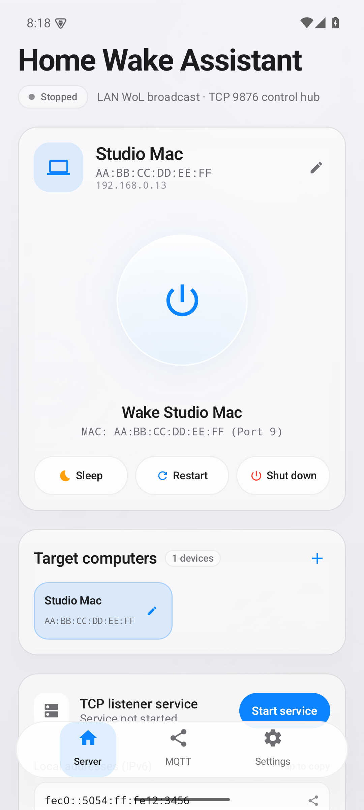
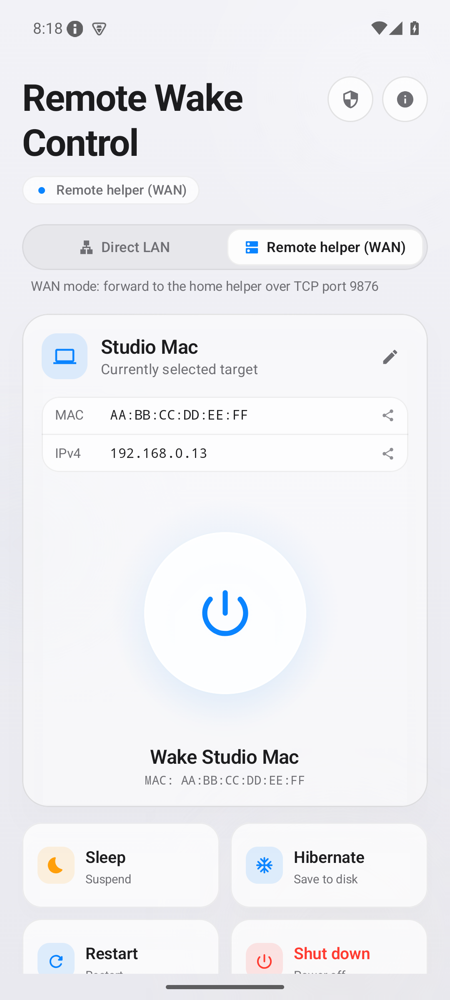
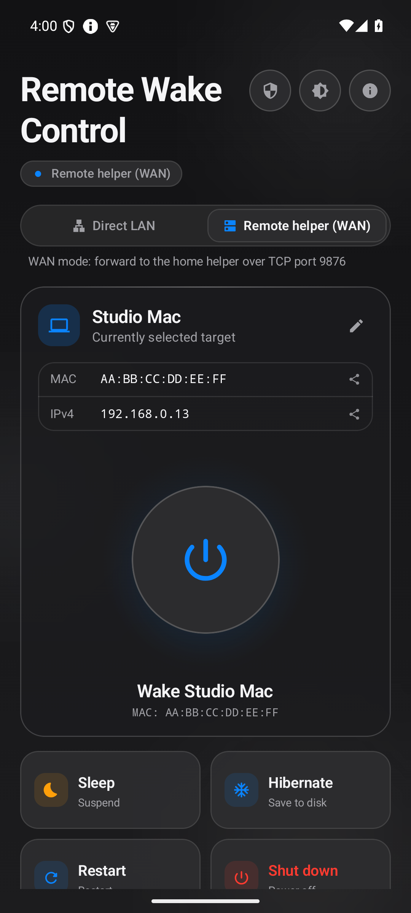
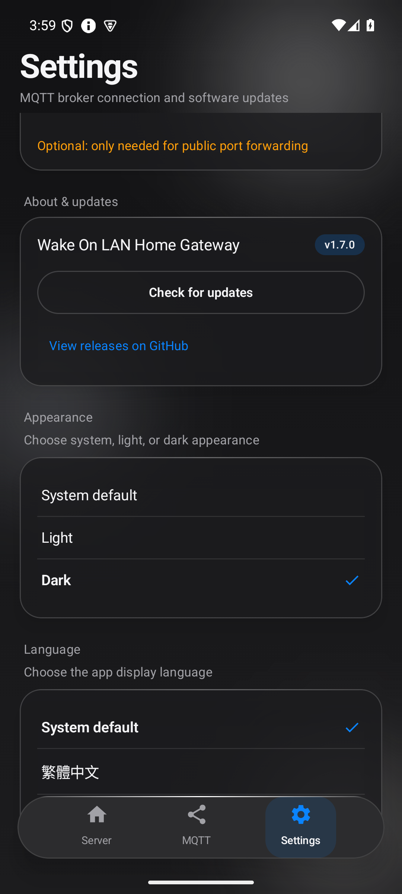
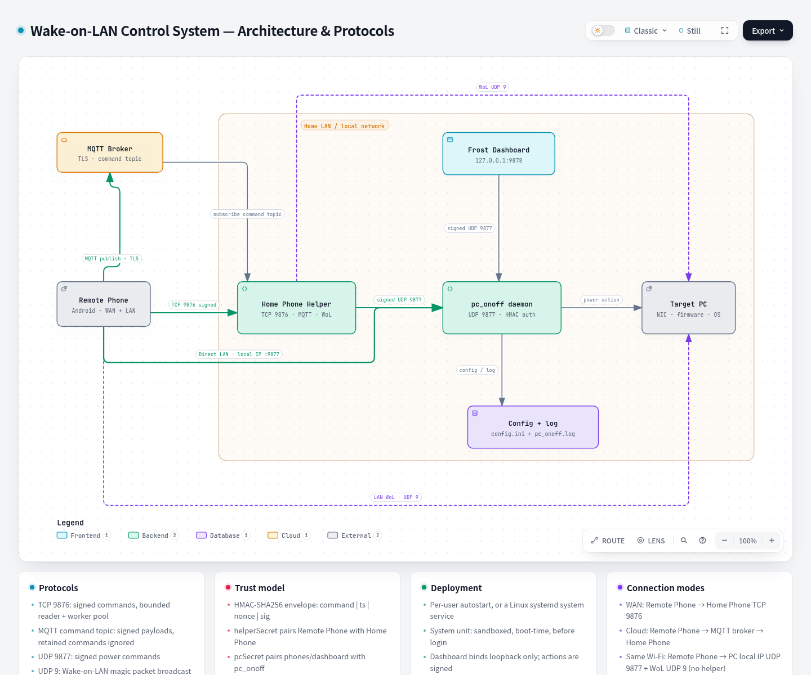

# Wake-on-LAN 與遠端電腦電源控制系統

[English README](README.md)

[](https://pinchiu.github.io/wake-on-lan-for-android/)
[](https://pinchiu.github.io/wake-on-lan-for-android/archify-explainer.html)
[](#2-home-assistant-與-google-home免費免-nabu-casa)
[](https://github.com/pinchiu/wake-on-lan-for-android/releases/latest)

一套跨平台遠端電源控制系統，支援對 Windows、Linux 與 macOS 電腦執行 **Wake-on-LAN 喚醒**、**關機**、**重新啟動**、**睡眠**、**休眠**與**鎖定螢幕**；可透過區域網路 Wi-Fi、Tailscale、Home Assistant / Google Home 語音，或備用 Android 家用手機網關從任何地方操作。

**目錄：** [選擇使用方式](#選擇使用方式) · [功能特色](#功能特色) · [介面截圖](#介面截圖) · [系統架構與文件](#系統架構與文件) · [下載](#下載) · [安裝與設定流程](#安裝與設定流程) · [安全模型](#安全模型) · [疑難排解](#疑難排解)

---

## 選擇使用方式

先在目標電腦安裝輕量 Rust 常駐守護程式（`pc_onoff`），再依您的網路環境選擇最適合的控制方式：

| 控制方式 | 需要準備 | 外網遠端控制 | 最適合情境 |
| :--- | :--- | :--- | :--- |
| **Home Assistant + Google Home** | 既有 Home Assistant + 免費 Tailscale Funnel（或 Nabu Casa / Cloudflare Tunnel） | 任何地方使用語音或 Google Home App | 免付月費實現語音開關機與重啟／睡眠／休眠／鎖定 |
| **Android 家用手機 + 外出手機** | 一台放家中的備用 Android 手機 + 隨身 Android 手機 | TCP 直連（Tailscale / IPv6）或 MQTT 雲端 | 沒有 Home Assistant 主機的環境 |
| **內網 Wi-Fi 直連** | 僅需隨身 Android 手機 | 家中 Wi-Fi（`Local LAN Mode`） | 只需要在家中區域網路內控制電腦 |

---

## 功能特色

- **電腦端電源守護程式（`pc_onoff`）**：Rust 編寫、零相依獨立執行檔，支援 Windows、Linux 與 macOS。自動註冊開機自啟動（Windows `HKCU Run`、Linux `systemd --user` / XDG、macOS `LaunchAgent`），Linux 另支援登入前生效的系統服務（`sudo pc_onoff --install-system`）、5 MB 自動日誌輪替（`pc_onoff.log`）與本機網頁儀表板（`pc_onoff --web-ui`）。
- **Home Assistant 與 Google Home 整合（`custom_components/pc_onoff`）**：零外部 PyPI 相依的 HACS 自訂整合，將每台電腦建立為主要開關、六個動作按鈕與連線狀態感測器。內建開機 25 秒樂觀狀態保持，並提供一鍵免費 Google Home 設定腳本（`scripts/setup-ha-google-home.sh`）與可重用的 AI Agent Skill。
- **Android 雙端 App（家用助手端 / 外出遙控端）**：支援多主機設定檔切換、具雙向確認（ACK）的 TCP 9876 直連、免連接埠轉發的 MQTT 雲端模式、內網直連模式、桌面單鍵小工具、Google 助理 / Gemini 語音捷徑（`wake_pc_shortcut`）與中英文介面切換。
- **安全與 Frost 介面設計**：內網與 Tailscale 免密鑰；公開 port-forward 自動套用 HMAC-SHA256 簽章與時間戳／防重放保護。兩款 Android App 與守護程式儀表板共用一致的 **Frost** 淺灰磨砂玻璃設計，支援系統／淺色／深色外觀（詳見 [`docs/frost-ui.md`](docs/frost-ui.md)）。

---

## 介面截圖

| 家用手機（淺色） | 外出手機（淺色） | 外出手機（深色） | 外觀設定（深色） | 區域儀表板 |
| :---: | :---: | :---: | :---: | :---: |
|  |  |  |  |  |

---

## 系統架構與文件



1. **外出手機 -> 家中助手手機（TCP 直連）**：透過 Tailscale 或公網 IPv6/IPv4 連線至 **TCP 9876**，具雙向執行結果回傳（`SUCCESS:` / `ERROR:`）。
2. **外出手機 -> 家中助手手機（MQTT 雲端）**：透過外部 MQTT Broker 轉發，適合無公網 IP 或嚴格 NAT 環境。
3. **家中助手手機 -> 目標電腦（內網中轉）**：透過 **UDP 9** 廣播 Wake-on-LAN 魔術封包（`255.255.255.255`），並透過 **UDP 9877** 發送電源指令。
4. **外出手機 -> 目標電腦（內網直連）**：連上家中 Wi-Fi 時，直接發送 UDP 9 / UDP 9877，不經助手手機。
5. **Google Home -> Home Assistant -> 目標電腦**：Google Home 將語音指令路由至 `custom_components/pc_onoff`，直接於內網送出相同的 **UDP 9** 與 **UDP 9877** 封包。

### 互動式架構與參考文件

| 文件入口 | 連結 | 說明 |
| :--- | :--- | :--- |
| **架構百科（Architecture Wiki）** | [pinchiu.github.io/wake-on-lan-for-android/](https://pinchiu.github.io/wake-on-lan-for-android/) | 三欄式互動架構百科、內嵌互動架構圖、完整中英文切換、即時搜尋與行級原始碼連結 |
| **Archify 互動式說明頁** | [archify-explainer.html](https://pinchiu.github.io/wake-on-lan-for-android/archify-explainer.html) | 單頁式視覺導覽，內含 4 張動畫圖（拓撲、25 秒保持時序、HMAC 信任流程、深層模組樹） |
| **協定與系統地圖** | [architecture.html](https://pinchiu.github.io/wake-on-lan-for-android/architecture.html) | 全畫布互動式元件與傳輸協定地圖（[PNG](docs/screenshots/architecture-frost.png)） |
| **Home Assistant 完整指南** | [`docs/home-assistant.md`](docs/home-assistant.md) | 雙語完整參考：HACS 安裝、實體清單、狀態偵測、Google Home 日常安排與排錯 |
| **AI Agent 自動化設定 Skill** | [`docs/skills/ha-google-home-pc-setup/SKILL.md`](docs/skills/ha-google-home-pc-setup/SKILL.md) | 可直接交給 AI Agent 執行端到端 Home Assistant + Google Home 自動化設定 |

<details>
<summary>Markdown 架構百科章節（docs/wiki/zh/）</summary>

- [`docs/wiki/zh/Home.md`](docs/wiki/zh/Home.md) — 1. 系統總覽與網關拓撲
- [`docs/wiki/zh/Architecture-and-Deep-Modules.md`](docs/wiki/zh/Architecture-and-Deep-Modules.md) — 2. 系統架構與深層模組
- [`docs/wiki/zh/Wire-Protocols-and-Security.md`](docs/wiki/zh/Wire-Protocols-and-Security.md) — 3. 傳輸協定與安全模型
- [`docs/wiki/zh/Subsystems-File-Map.md`](docs/wiki/zh/Subsystems-File-Map.md) — 4. 子系統檔案地圖

</details>

---

## 下載

所有預編譯執行檔、APK 與 Home Assistant 整合套件皆發布於 [GitHub Releases 頁面](https://github.com/pinchiu/wake-on-lan-for-android/releases/latest)：

| 元件 | 平台 | 檔案 | 用途 |
| :--- | :--- | :--- | :--- |
| **電腦守護程式（`pc_onoff`）** | Windows (x64) | `pc_onoff-windows-x86_64.exe`（或 `.zip`） | 背景常駐監聽 UDP 9877 電源指令 |
| **電腦守護程式（`pc_onoff`）** | Linux (x64) | `pc_onoff-linux-x86_64.AppImage` / 獨立執行檔 / `.tar.gz` | 免安裝 AppImage，可選系統層 systemd 服務 |
| **電腦守護程式（`pc_onoff`）** | macOS (Universal) | `pc_onoff-macos-universal.zip` / `.tar.gz` | 原生支援 Apple Silicon 與 Intel Mac |
| **Home Assistant 整合** | HA 2024.1+ | `pc_onoff-home-assistant.zip`（或 HACS） | 零外部相依 `custom_components/pc_onoff/` |
| **Android 家用助手端** | Android | `wakeonlan-home-phone.apk` | 安裝於家中備用手機作為網關 |
| **Android 外出遙控端** | Android | `wakeonwan-remote-phone.apk` | 安裝於隨身手機遠端操作 |

---

## 安裝與設定流程

### 1. 安裝電腦端電源守護程式（`pc_onoff`）

至 [Releases](https://github.com/pinchiu/wake-on-lan-for-android/releases/latest) 下載對應作業系統的執行檔：

- **Windows**：直接雙擊 `pc_onoff-windows-x86_64.exe`。預設背景監聽 UDP 9877、自動註冊 `HKCU\...\Run` 開機自啟動（免管理員權限）並寫入 `pc_onoff.log`。如需自動開通防火牆，以系統管理員執行一次：`pc_onoff.exe --firewall`。
- **Linux**：
  ```bash
  chmod +x pc_onoff-linux-x86_64.AppImage
  ./pc_onoff-linux-x86_64.AppImage
  ```
  預設註冊 `systemd --user` 與 XDG Autostart。若希望**開機後、尚未登入桌面時**也能接收關機／重啟指令，請安裝一次系統層服務：
  ```bash
  sudo ./pc_onoff-linux-x86_64.AppImage --install-system
  ```
  （安裝至 `/usr/local/bin/pc_onoff` 與 `/etc/systemd/system/pc_onoff.service`；移除請用 `sudo pc_onoff --uninstall-system`。）
- **macOS**：解壓縮 `pc_onoff-macos-universal.zip` 後執行：
  ```bash
  chmod +x pc_onoff
  ./pc_onoff
  ```
  自動安裝使用者 LaunchAgent（`~/Library/LaunchAgents/com.wakeonlan.pc_onoff.plist`），無須 root 權限。

<details>
<summary>守護程式 CLI 管理指令與本機 Frost 網頁儀表板</summary>

```bash
pc_onoff --status                # 查詢狀態、IP、連接埠、指令密鑰與自啟動設定
pc_onoff --log                   # 查看最近 25 行日誌
pc_onoff --stop                  # 停止背景執行中的守護程式
pc_onoff --install               # 啟用使用者層開機自啟動
pc_onoff --uninstall             # 解除使用者層開機自啟動
sudo pc_onoff --install-system   # Linux：安裝系統層開機服務（登入前可用）
sudo pc_onoff --uninstall-system # Linux：移除系統層服務
pc_onoff --web-ui                # 啟動本機 Frost 儀表板（http://127.0.0.1:9878）
pc_onoff --help                  # 顯示完整說明
```

`pc_onoff --web-ui` 僅綁定 loopback，顯示守護程式狀態與近期日誌，並透過標準 UDP 9877 協定送出五種電源操作（關機與重啟前會再次確認）。

</details>

---

### 2. Home Assistant 與 Google Home（免費、免 Nabu Casa）

Home Assistant 可直接擔任區域網路網關並橋接 Google Home，完整支援 **開機**、**關機**、**重新啟動**、**睡眠**、**休眠**與**鎖定螢幕**，不需要付費訂閱 Nabu Casa，也不需要申請 Google Service Account JSON。

[](https://my.home-assistant.io/redirect/hacs_repository/?owner=pinchiu&repository=wake-on-lan-for-android&category=integration)

#### 連線方案比較

| 方案 | 費用 | 需要準備 | 說明 |
| :--- | :--- | :--- | :--- |
| **Tailscale Funnel + Google Home Developer Console** | **免費** | HA 主機安裝 Tailscale | 免買網域、免路由器轉發；`report_state: false` 時**免 Service Account JSON** |
| **Cloudflare Tunnel + Google Home Developer Console** | 免費（需網域） | Cloudflare 帳號 + 網域 | 搭配一鍵腳本的 `--no-funnel --public-url https://ha.example.com` |
| **Nabu Casa（Home Assistant Cloud）** | 付費訂閱 | Nabu Casa 帳號 | 官方零設定雲端，於 **設定 -> 語音助理 -> 公開** 勾選 `switch.<pc>` 即可 |

#### 最快方式：一鍵自動化腳本或 AI Agent Skill

直接在 Home Assistant 主機執行內建腳本（建議先加 `--dry-run` 預覽）：

```bash
./scripts/setup-ha-google-home.sh \
  --ha-config ~/homeassistant/config \
  --project-id <GOOGLE_HOME_PROJECT_ID> \
  --entity-slug gaming_pc \
  --pc-name "Gaming PC"
```

腳本會自動完成：
1. 安裝 `custom_components/pc_onoff/` 到您的 HA 設定目錄。
2. 設定反向代理信任（針對 **HA 2026+** 自動修補 `.storage/http`，解決 `configuration.yaml` 的 `http:` 被忽略的問題；舊版 HA 則寫入 `configuration.yaml`）。
3. 檢查 `tailscale serve status`，依序挑選空閒 HTTPS 連接埠（`443 -> 8443 -> 10000`），絕不覆蓋既有服務，並啟用 Tailscale Funnel。
4. 以冪等方式於 `scripts.yaml` 加入 4 個 Google Home 動作腳本（`reboot` / `sleep` / `hibernate` / `lock`），並於 `configuration.yaml` 加入免 JSON 的 `google_assistant:` 設定。
5. 驗證設定、重啟 HA、實測公開端點（`GET /` -> `200`、`GET /auth/authorize` -> `200`、`POST /api/google_assistant` -> `401`），並印出精確的 Google Home Developer Console 複製貼上表。

> [!NOTE]
> 想讓 AI 代理直接幫您跑完整個流程？請將 [`docs/skills/ha-google-home-pc-setup/SKILL.md`](docs/skills/ha-google-home-pc-setup/SKILL.md) 提供給您的 AI Agent。

<details>
<summary>一鍵腳本常用參數</summary>

| 參數 | 用途 |
| :--- | :--- |
| `--https-port 8443` | 指定使用 8443 埠（當 443 已被其他服務占用時；未指定時會依 `443 -> 8443 -> 10000` 自動選擇） |
| `--no-funnel --public-url https://ha.example.com` | 沿用 Cloudflare Tunnel 或既有反向代理網址 |
| `--container ""` | 非 Docker 的 Home Assistant Core（預設容器名稱：`homeassistant`） |
| `--dry-run` | 僅預覽變更內容與指令，不修改任何檔案 |

</details>

#### 手動逐步設定指南

##### 步驟 A — 安裝整合並在 Home Assistant 介面新增電腦

1. 透過以下任一方式**安裝整合**，完成後重新啟動 Home Assistant：
   - **HACS（推薦）**：**HACS -> ⋮ -> 自訂儲存庫** -> 加入 `https://github.com/pinchiu/wake-on-lan-for-android`（類別：`Integration`）-> 下載 **Wake-on-LAN & PC Power (pc_onoff)**。
   - **Release ZIP**：
     ```bash
     curl -L -o /tmp/pc_onoff-home-assistant.zip \
       https://github.com/pinchiu/wake-on-lan-for-android/releases/latest/download/pc_onoff-home-assistant.zip
     unzip -o /tmp/pc_onoff-home-assistant.zip 'custom_components/*' -d /config
     ```
   - **手動複製**：`cp -r custom_components/pc_onoff /config/custom_components/pc_onoff`
2. **新增目標電腦**：前往 **設定 -> 裝置與服務 -> + 新增整合 -> Wake-on-LAN & PC Power (pc_onoff)**：

| 欄位 | 範例 | 說明 |
| :--- | :--- | :--- |
| **名稱 (Name)** | `Gaming PC` | Google Home 語音名稱（建立後不可修改） |
| **MAC 位址** | `AA:BB:CC:DD:EE:FF` | 接收 Wake-on-LAN 封包的有線網卡 |
| **主機 IP (Host IP)** | `192.168.1.50` | 靜態區域網路 IP（也支援 Tailscale 或公開 IP） |
| **PC 密鑰 (PC Secret)** | *(留空)* | 內網／Tailscale 可留空；公開 IP 必填 |
| **關機動作** | `shutdown` | `shutdown`、`sleep` 或 `hibernate` |
| **狀態偵測** | `ping` | `ping`（ICMP）、`tcp`（單一連接埠，預設 `445`）或 `none`（僅樂觀狀態） |

> [!WARNING]
> **Docker 使用者：** Home Assistant 容器必須使用 `network_mode: host`，UDP 9 的 Wake-on-LAN 廣播封包才能抵達電腦網卡。

**Home Assistant 如何偵測電腦狀態：** 預設每 `scan_interval`（30 秒）透過 `ping`（ICMP echo）或 `tcp`（連線 `probe_port`，即使回應 connection refused 也視為已開機）檢查電腦是否在線；選 `none` 則不輪詢。每次送出喚醒或關機後，開關會鎖定目標狀態 **25 秒**（`OPTIMISTIC_HOLD_SECONDS = 25.0`），並在 **+26 秒**進行一次對帳，避免 BIOS 開機期間 Google Home 誤跳回關閉。

##### 步驟 B — 啟用 Tailscale Funnel 與修正 HA 2026+ 反向代理設定

1. **避免 443 連接埠衝突**：Tailscale Funnel 僅開放 **443、8443、10000** 三個連接埠。請先執行 `tailscale serve status`，若 443 已被其他服務（如 CouchDB、Immich、Vaultwarden）占用，請改用 **8443**：
   ```bash
   sudo tailscale funnel --bg --https=8443 http://127.0.0.1:8123
   ```
   此時公開網址為 `https://<host>.<tailnet>.ts.net:8443`。
2. **信任反向代理（HA 2026+ 關鍵細節）**：在 Home Assistant **2026+** 中，一旦 `<ha-config>/.storage/http` 出現 `"yaml_migration_done": true`，寫在 `configuration.yaml` 的 `http:` 區塊會被**完全忽略**，導致 Funnel 請求回傳 **HTTP 400**（`your HTTP integration is not set-up for reverse proxies`）。請先停止 HA，將以下內容寫入 `.storage/http` 的 `data.stable` 內再重啟：
   ```json
   "use_x_forwarded_for": true,
   "trusted_proxies": ["127.0.0.1/32", "::1/128", "172.16.0.0/12"]
   ```
   *（尚未遷移的舊版 HA 則直接寫入 `configuration.yaml` 的 `http:` 區塊即可。）*

##### 步驟 C — 公開開關與 4 個額外動作（重啟、睡眠、休眠、鎖定）

Google Home 的開關元件僅支援開／關。若希望在 Google Home 操作**重啟**、**睡眠**、**休眠**與**鎖定螢幕**，請於 `scripts.yaml` 建立四個腳本，並在 `configuration.yaml` 同時公開 `switch` 與 `script`（`report_state: false` **不需要 Service Account JSON**）：

```yaml
# scripts.yaml
gaming_pc_reboot:
  alias: "Reboot Gaming PC"
  sequence:
    - action: button.press
      target:
        entity_id: button.gaming_pc_reboot

gaming_pc_sleep:
  alias: "Sleep Gaming PC"
  sequence:
    - action: button.press
      target:
        entity_id: button.gaming_pc_sleep

gaming_pc_hibernate:
  alias: "Hibernate Gaming PC"
  sequence:
    - action: button.press
      target:
        entity_id: button.gaming_pc_hibernate

gaming_pc_lock:
  alias: "Lock Gaming PC"
  sequence:
    - action: button.press
      target:
        entity_id: button.gaming_pc_lock_screen
```

```yaml
# configuration.yaml
google_assistant:
  project_id: <GOOGLE_HOME_PROJECT_ID>
  report_state: false
  expose_by_default: false
  exposed_domains:
    - switch
    - script
  entity_config:
    switch.gaming_pc:
      name: "Gaming PC"
      expose: true
    script.gaming_pc_reboot:
      name: "Reboot Gaming PC"
      expose: true
    script.gaming_pc_sleep:
      name: "Sleep Gaming PC"
      expose: true
    script.gaming_pc_hibernate:
      name: "Hibernate Gaming PC"
      expose: true
    script.gaming_pc_lock:
      name: "Lock Gaming PC"
      expose: true
```

重啟 Home Assistant 後，確認三個公開端點分別回傳 **200 / 200 / 401**：
```bash
curl -s -o /dev/null -w "GET / -> %{http_code}\n" <PUBLIC_URL>/
curl -s -o /dev/null -w "GET /auth/authorize -> %{http_code}\n" <PUBLIC_URL>/auth/authorize
curl -s -o /dev/null -w "POST /api/google_assistant -> %{http_code}\n" -X POST <PUBLIC_URL>/api/google_assistant
```

##### 步驟 D — 設定 Google Home Developer Console 並連結手機 App

1. 開啟 `https://console.home.google.com/projects/<PROJECT_ID>` -> **Cloud-to-cloud -> Add / Develop**，精確貼上以下數值：

| 欄位 | 精確數值 |
| :--- | :--- |
| **Development / Integration name** | `<PC 名稱>`（例如 `Gaming PC`） |
| **Device types** | `Switch` + `Scene` |
| **App icon** | 任一張 >= 144x144 的方形 PNG（儲存必要） |
| **Cloud fulfillment URL** | `<PUBLIC_URL>/api/google_assistant` |
| **OAuth Client ID** | `https://oauth-redirect.googleusercontent.com/r/<PROJECT_ID>` |
| **OAuth Client Secret** | 任一非空字串（例如 `ha-wol-secret-2026`） |
| **Authorization URL** | `<PUBLIC_URL>/auth/authorize` |
| **Token URL** | `<PUBLIC_URL>/auth/token` |

> [!WARNING]
> - 貼上網址時**絕對不能有前後空白**，否則 Google 會報錯 *Please enter a valid https link*。
> - **不要**使用 Google Cloud 的 `*.apps.googleusercontent.com` OAuth Client ID（那是給對外 Google Assistant SDK 用），請完整填入 `https://oauth-redirect.googleusercontent.com/r/<PROJECT_ID>`。
> - `report_state: false` 模式**不需要 Service Account JSON**。

2. 依序點擊 **Save -> Test -> Start testing**（不需要提交公開發布審查）。
3. 手機上以**同一個 Google 帳號**登入 **Google Home App**，先完全關閉再重新開啟 -> **裝置 -> + 新增 -> 與 Google Home 相容的裝置** -> 選擇 **`[test] <PC 名稱>`** -> 登入 Home Assistant。
4. **日後新增動作腳本的同步方式**：因 `report_state: false` 不會主動推送新裝置，新增腳本後請在手機 Google Home App 點選 **設定 -> 與 Google 相容 -> `[test] <PC 名稱>` -> 重新連結帳號**（或**重新檢查新裝置**）。

連結完成後即可使用語音控制：
- 「Ok Google，打開 Gaming PC」／「Ok Google，關閉 Gaming PC」
- 「Ok Google，啟動 Reboot Gaming PC」（或在 **Google Home -> 自動化 / 日常安排** 將重啟／睡眠／休眠／鎖定綁定自訂中文口令）

---

### 3. Android 應用程式（家用助手端與外出遙控端）

1. 將 `wakeonlan-home-phone.apk` 安裝在家中備用手機（連上家中 Wi-Fi），將 `wakeonwan-remote-phone.apk` 安裝在隨身手機（若提示未知來源請允許安裝）。
2. 選擇連線模式：
   - **TCP 直連模式（推薦搭配 Tailscale 或 IPv6）**：在家用手機 App 點擊 **Start Service** 查看 TCP 9876 監聽位址；在外出手機新增目標電腦（MAC 與內網 IPv4）並填入家用手機位址，即可操作 `WAKE`、`SHUTDOWN`、`REBOOT`、`SLEEP`、`HIBERNATE`、`LOCK`。
   - **MQTT 雲端模式**：兩台手機填入相同的 Broker Host、Port、帳號、密碼與 Topic，指令格式為 `WAKE:<MAC>`、`SHUTDOWN:<IP>`、`REBOOT:<IP>`、`SLEEP:<IP>`、`HIBERNATE:<IP>`、`LOCK:<IP>`。
   - **內網直連模式**：外出手機連上家中 Wi-Fi 時，開啟 **Local LAN Mode** 即可直接對電腦發送指令，無須經過助手手機。

---

## 安全模型

建議優先使用 **Tailscale** 或家用私有 Wi-Fi。來自私有網段與 Tailscale 的指令**完全免密鑰**：

- **IPv4**：`10/8`、`172.16/12`、`192.168/16`、`169.254/16`、`127/8`、`100.64/10`（Tailscale）
- **IPv6**：`::1`、`fe80::/10`、`fc00::/7`（包含 Tailscale `fd7a:115c:a1e0::/48`）

僅有**公開 IPv6/IPv4 port-forward** 需要 HMAC-SHA256 密鑰。於設定貼上一次後，系統會自動簽章，並以 +/-5 分鐘時間戳（請保持 NTP 校時）與 10 分鐘 Nonce 快取防止重放攻擊：

```text
SHUTDOWN:192.168.1.10|ts=1700000000|nonce=0011223344556677|sig=<hmac-sha256-hex>
```

| 密鑰 | 取得方式 | 填入位置 |
| :--- | :--- | :--- |
| **PC 密鑰** | `pc_onoff --status` -> `Command Secret: ...` | 目標電腦設定檔 -> PC secret（全域設定僅作為留空時的備援） |
| **Helper 密鑰** | 家用手機 -> 設定 -> 安全性 -> Helper secret（Generate） | 外出手機 -> 盾牌圖示 -> Helper secret |

MQTT 依賴 Broker 的 TLS、帳密與主題權限（不使用 HMAC）。切勿在未啟用 HMAC 密鑰的情況下將 UDP 9877 或 TCP 9876 直接暴露於公網。

---

## 疑難排解

| 問題現象 | 常見原因 | 解決方式 |
| :--- | :--- | :--- |
| **WoL 無法喚醒電腦** | BIOS／網卡未開啟喚醒、Windows 快速啟動開啟，或 Docker 使用橋接網路 | 在 BIOS 開啟 Wake-on-LAN / PCIe 電源喚醒；Windows 裝置管理員勾選魔術封包喚醒並關閉快速啟動；HA Docker 容器須用 `network_mode: host` |
| **關機／睡眠沒有反應** | 守護程式未啟動或防火牆擋住 UDP 9877 | 執行 `pc_onoff --status` 檢查；開通 UDP 9877（Windows 管理員執行 `pc_onoff.exe --firewall`、Linux `sudo ufw allow 9877/udp`、macOS 允許傳入連線） |
| **Tailscale Funnel 回傳 HTTP 400** | HA 2026+ 遷移後忽略 `configuration.yaml` 的 `http:` 區塊 | 停止 HA 後修補 `.storage/http` 的 `data.stable`（加入 `use_x_forwarded_for` 與 `trusted_proxies`），或直接執行 `scripts/setup-ha-google-home.sh` |
| **Developer Console 拒絕 HTTPS 網址** | 網址前後多出空白或填錯 OAuth Client ID | 清除空白；OAuth Client ID 必須填 `https://oauth-redirect.googleusercontent.com/r/<PROJECT_ID>` |
| **Google Home 看不到新增的重啟／睡眠／鎖定動作** | `report_state: false` 不會自動同步新實體 | 手機 Google Home App：**設定 -> 與 Google 相容 -> `[test] <名稱>` -> 重新連結帳號** |
