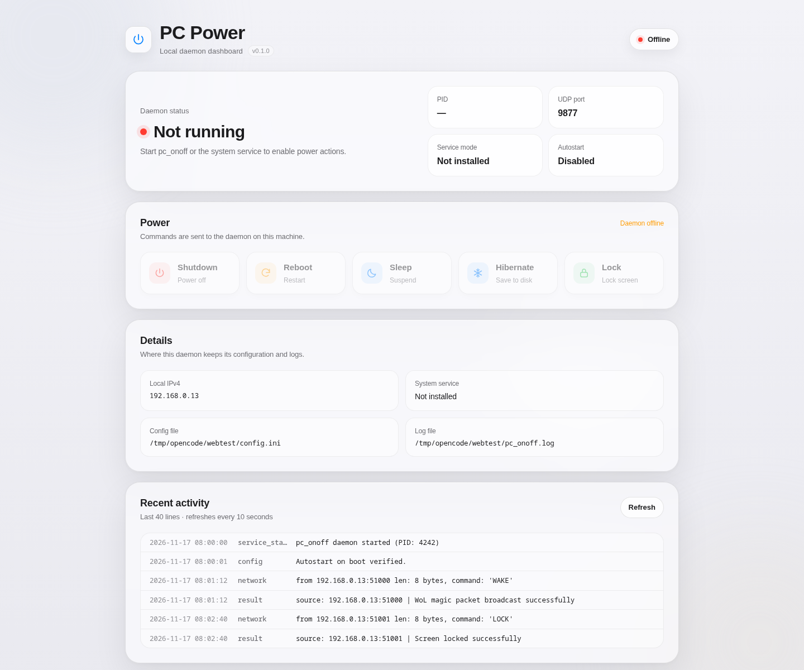

# Wake-on-LAN 家用手機遠端喚醒控制系統
[English README](README.md)

一套完整的跨平台遠端控制系統，利用備用 Android 手機作為「家用網關／助手」，透過行動網路、網際網路與區域網路，對電腦進行 Wake-on-LAN (WoL) 遠端喚醒、關機、重啟、睡眠、休眠與螢幕鎖定控制。

## 功能特色
- **Wake-on-LAN 遠端喚醒**：支援透過區域網路 UDP 廣播，或透過外網 TCP / MQTT 遠端喚醒電腦。
- **遠端電源與工作階段控制**：遠端執行關機 (Shutdown)、重啟 (Reboot)、睡眠 (Sleep)、休眠 (Hibernate) 與螢幕鎖定 (Lock Screen)。
- **可靠的雙手機直連架構 (TCP)**：外出手機與家中助手端透過 IPv6/IPv4 以 TCP (Port 9876) 建立連線，具備即時雙向確認 (ACK) 與狀態回傳反饋。
- **內網直連模式 (Local LAN Mode)**：當外出手機連上家中 Wi-Fi 時，可切換為內網模式直接透過 UDP (Port 9) 發送 Magic Packet 與 UDP (Port 9877) 發送控制封包，無須經過助手手機中轉。
- **MQTT 雲端模式**：可連線至任何 MQTT Broker (如 HiveMQ、EMQX、Adafruit IO 等)，無須設定路由器連接埠轉發即可跨防火牆控制。
- **多主機設定檔管理 (Multi-Profile)**：外出手機支援儲存多台目標電腦（名稱、MAC 地址、內網 IP），隨時一鍵切換控制對象。
- **雙端桌面捷徑小工具 (App Widgets)**：
  - *家用助手端小工具*：桌面單鍵發送內網 WoL 廣播，立即喚醒預設電腦並顯示時間戳記。
  - *外出遙控端小工具*：顯示當前選定之電腦名稱，單鍵發送遠端喚醒。
- **語音助理整合**：支援 Google 助理 / Gemini 日常安排 (Routine) 語音捷徑 (`wake_pc_shortcut`)，說句語音指令立即喚醒。
- **雙語介面支援**：手機 App 設定內建即時切換繁體中文與英文介面。
- **指令安全**：內網／Tailscale 免密鑰；公開 port-forward 第一次使用 HMAC，之後以 TOFU 記住來源；MQTT 依賴 broker 帳密與主題權限。
- **Frost 介面設計**：兩款 Android App 採用 Apple 風格的淺灰玻璃質感 — 半透明卡片、細緻描邊、系統字體與單一 iOS 藍色強調色；Rust 守護程式也提供相同風格的區域網頁儀表板。
- **跨平台電腦端常駐守護程式 (`pc_onoff`)**：使用 Rust 開發之高效獨立執行檔，支援 Windows、Linux 與 Apple macOS。
  - 無需管理員權限之開機自啟動（Windows 註冊表 `HKCU Run`、Linux `systemd --user` / XDG Autostart、macOS `LaunchAgent`）。
  - 選用 Linux 系統層服務（`sudo pc_onoff --install-system`），開機後、登入前即可接收指令。
  - 區域網頁儀表板（`pc_onoff --web-ui`），可查看狀態、日誌並執行電源操作。
  - 自動 5 MB 日誌滾動輪替 (`pc_onoff.log`)。
  - 豐富的命令列 (CLI) 管理指令。

## 下載

您可以從 [GitHub Releases 發行頁面](https://github.com/pinchiu/wake-on-lan-for-android/releases) 下載最新預先建置完成的檔案：

### Android 應用程式
- `wakeonlan-home-phone.apk`：安裝於放置在家中且與目標電腦連接同一 Wi-Fi 網路的備用手機（助手端／網關）。
- `wakeonwan-remote-phone.apk`：安裝於隨身攜帶的外出手機（遙控器端）。

### 電腦端電源控制守護程式 (`pc_onoff`)
- **Windows**：`pc_onoff-windows-x86_64.exe` (或 `.zip`) — 64 位元獨立執行檔，免安裝直接執行。
- **Linux**：`pc_onoff-linux-x86_64.AppImage` (或獨立二進位檔 `pc_onoff-linux-x86_64` / `.tar.gz`) — 免安裝 AppImage，隨點隨開，支援各大主流 Linux 發行版。
- **Apple macOS**：`pc_onoff-macos-universal.zip` (或 `.tar.gz` / 獨立執行檔 `pc_onoff-macos-universal`) — 通用二進位檔 (Universal Binary)，原生支援 Apple Silicon (M1/M2/M3/M4) 與 Intel Mac。

## 指令安全（內網／Tailscale 優先）

**強烈建議使用 Tailscale**（或直接在家用 Wi-Fi 內網）。來自私有網段與 Tailscale 的指令
**完全不需要密鑰**：

- IPv4：`10/8`、`172.16/12`、`192.168/16`、`169.254/16`、`127/8`、`100.64/10`（Tailscale）。
- IPv6：`::1`、`fe80::/10`、`fc00::/7`（包含 Tailscale `fd7a:115c:a1e0::/48`）。

只有**公開 IPv6／IPv4 port-forward** 才需要第一次 HMAC 驗證；成功後會記住該來源（TOFU），
之後同一來源不用再簽章。可用 `pc_onoff --forget-trusted` 清除守護程式記住的公開來源；
家用手機的來源清單可透過清除 App 資料重置。

MQTT **不使用 HMAC**，改依賴 broker 的 TLS、帳號密碼與主題權限（訂閱端看不到發佈者 IP）。

```text
SHUTDOWN:192.168.1.10|ts=1700000000|nonce=0011223344556677|sig=<hmac-sha256-hex>
```

公開 port-forward 只需設定一次：

| 密鑰 | 取得方式 | 貼到哪裡 |
| :--- | :--- | :--- |
| **PC 密鑰** | `pc_onoff --status` → `Command Secret: ...` | 家用手機 → 設定 → 安全性 → PC secret；外出手機 → 盾牌圖示 → PC secret |
| **Helper 密鑰** | 家用手機 → 設定 → 安全性 → Helper secret（Generate） | 外出手機 → 盾牌圖示 → Helper secret |

時間戳需在 ±5 分鐘內（請保持 NTP 同步），Nonce 會保留 10 分鐘。不要把 UDP 9877／TCP 9876
直接暴露到公網而不設 HMAC；能用 Tailscale 就不要用 port-forward。

## Frost 介面設計

兩款 Android App 與 Rust 守護程式的區域儀表板共用同一套 **Frost** 設計語言：

- 以溫暖中性灰 (`#F2F2F7` → `#E9E9EF`) 為基底，不使用純黑或霓虹色。
- 半透明磨砂卡片、細緻描邊、22–28 dp 圓角與柔和陰影。
- 系統 (SF 風格) 字體、語句式標籤與充足留白。
- 單一 iOS 藍 (`#0A84FF`) 強調色，搭配 iOS 綠／橘／紅作為狀態提示。
- 180–320 ms 的平穩動態；沒有 HUD 掃描線、霓虹光暈或全大寫標題。

Android App 以淺色玻璃為主；網頁儀表板同時支援淺色與深色 (`prefers-color-scheme`)。完整設計
權杖與元件規範請見 [`docs/frost-ui.md`](docs/frost-ui.md)。

## 介面截圖

| 家用手機 | 外出手機 | 設定頁 | 區域儀表板 |
| :---: | :---: | :---: | :---: |
|  |  |  |  |

## 通訊架構與協定說明

[互動式系統架構與協定圖](docs/architecture.html) · [PNG](docs/screenshots/architecture-frost.png)


1. **外出手機 -> 家中助手手機 (外網 TCP 直連模式)**：
   - 使用 **TCP (Port 9876)** 透過公網 IPv6 / IPv4 傳輸。
   - 保證封包可靠送達並即時接收助手端回傳的執行結果 (`SUCCESS: ...` 或 `ERROR: ...`)。
2. **外出手機 -> 家中助手手機 (MQTT 雲端模式)**：
   - 使用 **MQTT (TCP/TLS)** 透過外部 Broker 轉發。
   - 適合無公網 IPv6 或受限於嚴格 NAT 防火牆之環境。
3. **家中助手手機 -> 目標電腦 (內網中轉喚醒與控制)**：
   - WoL 喚醒：透過 **UDP (Port 9)** 發送 Magic Packet 廣播至 `255.255.255.255`。
   - 電腦控制：透過 **UDP (Port 9877)** 發送控制指令至執行 `pc_onoff` 之電腦 IP。
4. **外出手機 -> 目標電腦 (內網直連模式)**：
   - 當外出手機連上家中 Wi-Fi 時，可直接對區域網路發送廣播與控制指令。

## 安裝與設定流程

### 1. 電腦端電源控制守護程式 (`pc_onoff`)

至 [GitHub Releases 發行頁面](https://github.com/pinchiu/wake-on-lan-for-android/releases) 下載適用於您作業系統的建置產物。

#### Windows 啟動方式
直接雙擊 `pc_onoff-windows-x86_64.exe`（或 `pc_onoff.exe`）即可！
- 預設立即於背景常駐監聽 UDP 9877（無黑視窗、無多餘 GUI 打擾）。
- 自動完成開機自動啟動設定（註冊至 `HKCU Run`，免管理員權限）。
- 自動於同目錄建立 `pc_onoff.log` 紀錄本機 IP、連線來源與所有遠端電源指令。
- 若需自動設定防火牆，請以管理員身分執行：`pc_onoff.exe --firewall`。

#### Linux 啟動方式
- **AppImage（推薦）**：
  ```bash
  chmod +x pc_onoff-linux-x86_64.AppImage
  ./pc_onoff-linux-x86_64.AppImage
  ```
- **獨立二進位檔**：
  ```bash
  chmod +x pc_onoff-linux-x86_64
  ./pc_onoff-linux-x86_64
  ```
- 自動註冊 `systemd --user` 服務與 XDG Autostart，登入後自動常駐。

#### 開機後、登入前即可控制（Linux）
預設的 `systemd --user` / XDG Autostart 只會在**使用者登入後**才啟動，因此剛開機停在登入畫面的電腦不會回應關機／重啟指令。安裝一次系統層服務即可解決：
```bash
sudo ./pc_onoff-linux-x86_64.AppImage --install-system   # 或：sudo ./pc_onoff --install-system
```
此指令會將執行檔複製到 `/usr/local/bin/pc_onoff`、安裝 `/etc/systemd/system/pc_onoff.service`（以 root 執行、加入 `multi-user.target`、開機即啟動）、把設定與日誌放在 `/var/lib/pc_onoff/`，並移除個人 autostart 以避免兩者搶佔 UDP 9877。解除安裝：`sudo pc_onoff --uninstall-system`。

#### Apple macOS 啟動方式
下載並解壓縮 `pc_onoff-macos-universal.zip`。
```bash
chmod +x pc_onoff
./pc_onoff
```
- 自動於 `~/Library/LaunchAgents/com.wakeonlan.pc_onoff.plist` 註冊使用者的 LaunchAgent，開機登入後自動常駐，完全無需管理者 (root) 權限。
- 透過 AppleScript System Events（關機、重新啟動）、`pmset`（睡眠、休眠）與 `CGSession`（鎖定畫面）安全執行操作。

#### 守護程式 CLI 管理指令
`pc_onoff` 提供豐富的命令列管理指令：
```bash
pc_onoff --status                # 查詢執行狀態、IP、連接埠、autostart 與系統服務狀態
pc_onoff --log                   # 查看最近 25 筆執行日誌
pc_onoff --stop                  # 停止背景執行中的守護程式
pc_onoff --install               # 啟用開機自啟動
pc_onoff --uninstall             # 解除開機自啟動
sudo pc_onoff --install-system   # Linux：安裝開機即啟動的系統服務（登入前可用）
sudo pc_onoff --uninstall-system # Linux：移除系統服務
pc_onoff --web-ui                # 區域 Frost 儀表板（http://127.0.0.1:9878）
pc_onoff --help                  # 顯示使用說明
```

#### 區域 Frost 儀表板（選用）
```bash
pc_onoff --web-ui
# Dashboard: http://127.0.0.1:9878
```
儀表板是一個獨立的前景程序（不會再啟動第二個守護程式），僅綁定 loopback，顯示守護程式狀態、
本機 IP、自啟動／系統服務狀態與最近日誌，並透過標準 UDP 9877 協定送出五種電源指令（使用守護程式的指令密鑰簽章）；關機與
重新啟動前會顯示確認視窗。頁面支援淺色與深色 `prefers-color-scheme`，並與 Android App 共用
Frost 設計系統。

### 2. 安裝 Android 應用程式

1. 從 [GitHub 發行頁面](https://github.com/pinchiu/wake-on-lan-for-android/releases) 下載 APK 並安裝：
   - `wakeonlan-home-phone.apk`
   - `wakeonwan-remote-phone.apk`
2. 若系統提示未知來源應用程式，請於 Android 設定中允許安裝。

### 3. 使用方式

#### A. TCP 直連模式（推薦具備 IPv6 之網路）
1. 開啟 **家中助手手機 App** 並點擊啟動服務。畫面上將顯示目前本機在 TCP Port 9876 上的 IPv6 / IPv4 監聽位址。
2. 開啟 **外出手機 App**：
   - 新增電腦設定檔（填入目標電腦 MAC 與區域網路 IPv4）。
   - 填入家中助手手機的 IPv6 位址。
   - 點擊 **WAKE**、**SHUTDOWN**、**REBOOT**、**SLEEP**、**HIBERNATE** 或 **LOCK**。
   - 狀態欄將即時顯示家中助手手機回傳的具體執行結果。

#### B. MQTT 雲端模式
1. 於兩台手機 App 中設定相同的 MQTT Broker 參數（Host、Port、帳號、密碼與 Topic）。
2. 發送標準指令至設定的 Topic：
   - `WAKE:<MAC>`
   - `SHUTDOWN:<IP>`
   - `REBOOT:<IP>`
   - `SLEEP:<IP>`
   - `HIBERNATE:<IP>`
   - `LOCK:<IP>`

#### C. 內網直連模式
1. 當外出手機連上家中 Wi-Fi 時，於 App 內開啟 **Local LAN Mode**。
2. 指令將直接透過本機廣播與 UDP 發送至電腦，無需經過助手手機。

## 疑難排解
- **WoL 無法喚醒電腦**：
  - 請確認主機板 BIOS/UEFI 已開啟 Wake-on-LAN（或 PCIe 電源喚醒）。
  - 在 Windows 裝置管理員中，開啟網路卡內容，勾選「允許這個裝置喚醒電腦」與「只允許 Magic 封包喚醒電腦」。
- **遠端關機/睡眠沒有反應**：
  - 確認守護行程正在執行：執行 `pc_onoff --status`。
  - 確認防火牆已允許 UDP 9877 通行：
    - Windows：以管理員身分執行 `pc_onoff.exe --firewall` 或手動於 Windows Defender 防火牆新增輸入 UDP 9877 規則。
    - Linux：若啟用 `ufw`，執行 `sudo ufw allow 9877/udp`。
    - macOS：請至「系統設定」→「網路」→「防火牆」，若有跳出提示請允許 `pc_onoff` 的傳入連線。
