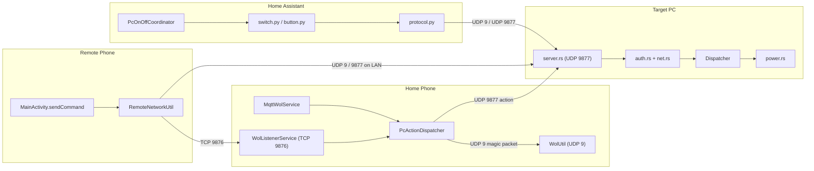
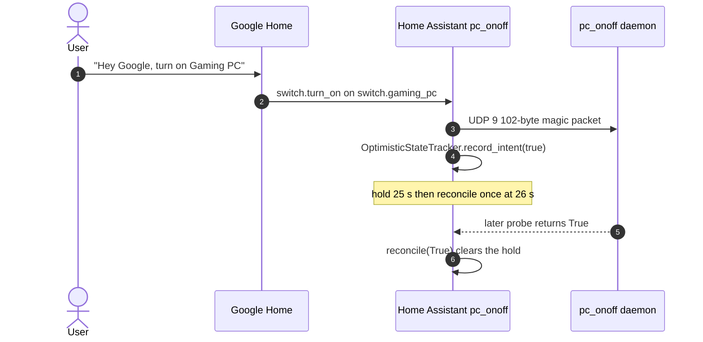
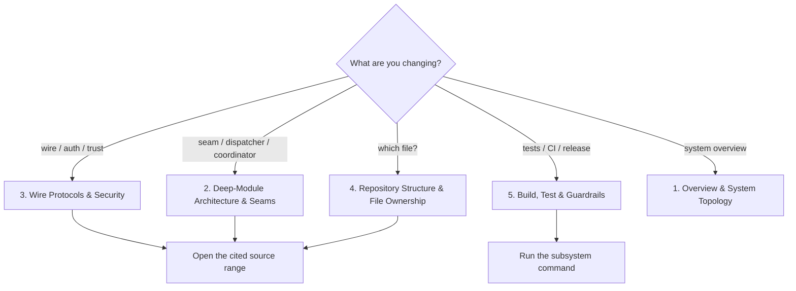

<div class="wiki-breadcrumb">docs/wiki / 1. Overview &amp; System Topology</div>

# 1. Overview & System Topology

<details class="relevant-sources">
<summary>Relevant source files</summary>

- [`computer/src/lib.rs`](../../computer/src/lib.rs#L1-L35)
- [`computer/src/server.rs`](../../computer/src/server.rs#L49-L164)
- [`computer/src/auth.rs`](../../computer/src/auth.rs#L93-L200)
- [`wakeonlanhomephone/app/src/main/java/com/example/wakeonlanhomephone/PcActionDispatcher.kt`](../../wakeonlanhomephone/app/src/main/java/com/example/wakeonlanhomephone/PcActionDispatcher.kt#L22-L175)
- [`wakeonlanhomephone/app/src/main/java/com/example/wakeonlanhomephone/WolListenerService.kt`](../../wakeonlanhomephone/app/src/main/java/com/example/wakeonlanhomephone/WolListenerService.kt#L81-L300)
- [`wakeonwanremotephone/app/src/main/java/com/example/wakeonwanremotephone/RemoteNetworkUtil.kt`](../../wakeonwanremotephone/app/src/main/java/com/example/wakeonwanremotephone/RemoteNetworkUtil.kt#L15-L216)
- [`custom_components/pc_onoff/const.py`](../../custom_components/pc_onoff/const.py#L1-L36)
- [`custom_components/pc_onoff/protocol.py`](../../custom_components/pc_onoff/protocol.py#L69-L440)
- [`custom_components/pc_onoff/coordinator.py`](../../custom_components/pc_onoff/coordinator.py#L210-L361)

</details>

<div class="archify-cta">✨ <a href="archify-explainer.html"><strong>Interactive Archify Explainer (互動式架構圖解)</strong></a> — the visual 1-page companion to these 5 chapters.</div>

## 1.1 Purpose & Core Subsystems

The repository is one remote power-control ecosystem, not four independent apps. A **Target PC** runs the Rust `pc_onoff` daemon (`computer/`) on UDP 9877 and keeps NIC Wake-on-LAN enabled on UDP 9. It is reached through one of two LAN gateways:

1. a spare Android **Home Phone** (`wakeonlanhomephone/`) that listens on TCP 9876, subscribes to MQTT, handles voice shortcuts and widgets, and forwards to LAN UDP 9/9877; or
2. **Home Assistant** (`custom_components/pc_onoff/`) that exposes a Google Home on/off switch, six action buttons, and a connectivity sensor.

The **Remote Phone** (`wakeonwanremotephone/`) can use either gateway over TCP 9876, or bypass both on the local LAN with direct UDP 9/9877.

| Subsystem | Directory | Runtime | Network role | Primary source |
| :--- | :--- | :--- | :--- | :--- |
| Target PC daemon | `computer/` | Windows / Linux / macOS, Rust 2024, zero crates | Listens UDP **9877** (IPv4 required, IPv6 best effort); NIC WoL **UDP 9**; dashboard **127.0.0.1:9878** | [`lib.rs`](../../computer/src/lib.rs#L1-L35), [`server.rs`](../../computer/src/server.rs#L54-L118) |
| Home Phone gateway | `wakeonlanhomephone/` | Android, Kotlin/Compose | Listens TCP **9876**; MQTT client (1883/8883); sends UDP **9** + **9877** | [`PcActionDispatcher.kt`](../../wakeonlanhomephone/app/src/main/java/com/example/wakeonlanhomephone/PcActionDispatcher.kt#L22-L175) |
| Home Assistant gateway | `custom_components/pc_onoff/` | Python 3.11+, HA 2024.1+, zero PyPI deps | Outbound UDP **9** + **9877**; Google Home switch/buttons | [`protocol.py`](../../custom_components/pc_onoff/protocol.py#L69-L440) |
| Remote Phone | `wakeonwanremotephone/` | Android, Kotlin/Compose | TCP **9876** relay, or direct LAN UDP **9** + **9877** | [`RemoteNetworkUtil.kt`](../../wakeonwanremotephone/app/src/main/java/com/example/wakeonwanremotephone/RemoteNetworkUtil.kt#L15-L216) |



<div class="decision-context">
<div class="decision-title">Why It Works This Way / 設計決策背景 <span>(Decision Context)</span></div>
<div class="lang-en">
<p><strong>The PC does not need IPv6 or a cloud account.</strong> The target daemon only has to accept one authenticated UDP 9877 datagram and execute the OS power call. The Home Phone or Home Assistant acts as the LAN bridge: WAN/Google Home terminates at the gateway, which re-emits the LAN-native UDP 9 magic packet and UDP 9877 action. Keeping the target simple reduces OS firewall, driver and sleep-state failure modes.</p>
<p><strong>LAN and Tailscale are secret-free; public IPs fail closed.</strong> A trusted source already proves local-network or Tailscale membership, so demanding a shared secret there would add friction without a meaningful boundary. A public packet has no such proof, so it must carry HMAC-SHA256; a missing, invalid or replayed envelope is rejected instead of falling back to plaintext.</p>
</div>
<div class="lang-zh">
<p><strong>目標 PC 不需要 IPv6 或雲端帳號。</strong> 目標常駐程式只需要接收一個已驗證的 UDP 9877 datagram，然後執行作業系統電源指令。WAN / Google Home 的連線由 Home Phone 或 Home Assistant 這個 LAN 閘道終結，再由閘道發出 LAN 原生的 UDP 9 magic packet 與 UDP 9877 指令。目標端保持簡單，可減少防火牆、網卡驅動與睡眠狀態造成的失敗模式。</p>
<p><strong>LAN 與 Tailscale 免密鑰；公網一律 fail closed。</strong> 信任來源已證明自己位於區域網路或 Tailscale，強制共享密鑰只會增加摩擦，卻沒有實質邊界。公網封包沒有這種證明，因此必須攜帶 HMAC-SHA256；缺少、錯誤或重放的 envelope 一律拒絕，絕不回退成明文。</p>
</div>
</div>

<div class="zh-summary lang-zh">
<strong>繁體中文決策摘要</strong>
<ul>
<li>目標 PC 只需監聽 UDP 9877，並由網卡處理 UDP 9 喚醒；IPv6 與雲端連線由閘道負責。</li>
<li>Home Phone 與 Home Assistant 是 WAN / Google Home 到 LAN 廣播域的橋接器。</li>
<li>LAN / Tailscale 信任來源可送明文指令；公網必須使用 HMAC-SHA256，且失敗時關閉。</li>
</ul>
</div>

Sources: [computer/src/lib.rs:1-35](../../computer/src/lib.rs#L1-L35), [computer/src/server.rs:54-118](../../computer/src/server.rs#L54-L118), [custom_components/pc_onoff/const.py:1-36](../../custom_components/pc_onoff/const.py#L1-L36), [docs/home-assistant.md:1-60](../home-assistant.md#L1-L60)

## 1.2 End-to-End Command Routing Topology

There are three transport stories, but only two wire payload families: the 102-byte magic packet and the `action` datagram/envelope.

| Route | Ingress | Gateway behavior | Wire to PC | Acknowledgement |
| :--- | :--- | :--- | :--- | :--- |
| Google Home → HA → PC | `switch.turn_on/off` or button press | HA reads `PcTargetConfig`, sends magic packet or action | UDP 9 or UDP 9877 from HA host | None; HA updates optimistic state |
| Remote Phone → Home Phone → PC | TCP 9876 line | Helper authenticates public sources, dispatches, writes result line | UDP 9 or UDP 9877 from phone | `SUCCESS:` / `ERROR:` line |
| Remote Phone → PC (LAN) | Local UI / widget | No gateway; direct sockets | UDP 9 or UDP 9877 | None |
| MQTT publisher → Home Phone → PC | MQTT topic | Broker ACL/TLS is the boundary; retained commands ignored | UDP 9 or UDP 9877 | MQTT QoS 1, not a PC ack |



```text
WoL            UDP 9    102 bytes = 6 x 0xFF + 16 x MAC; no ack
Helper TCP     9876     <command-or-envelope>\n -> SUCCESS: ... | ERROR: ...; request <= 512 B
Daemon UDP     9877     shutdown|reboot|sleep|hibernate|lock; <= 1024 B; no ack
Trusted IPv4   127.0.0.0/8, 10.0.0.0/8, 172.16.0.0/12, 192.168.0.0/16, 169.254.0.0/16, 100.64.0.0/10
Trusted IPv6   ::1, fe80::/10, fc00::/7; ::ffff:a.b.c.d is unwrapped; fec0::/10 is NOT trusted
Public         command|ts=<unix>|nonce=<16 lowercase hex>|sig=<64 lowercase hex>; +/-300 s
HMAC vector    secret 0123456789abcdef0123456789abcdef, ts 1700000000, nonce 0011223344556677
               SHUTDOWN:192.168.1.10 -> sig 6582b1c23ef97498af3f91ade1a74ce60f335dae38a2aa51f403254505fbfbdc
HA hold        25.0 s optimistic, one reconcile at +26 s; probe_mode "none" never polls
Dashboard      http://127.0.0.1:9878  (loopback only, foreground --web-ui)
```

Sources: [wakeonlanhomephone/app/src/main/java/com/example/wakeonlanhomephone/WolListenerService.kt:81-300](../../wakeonlanhomephone/app/src/main/java/com/example/wakeonlanhomephone/WolListenerService.kt#L81-L300), [wakeonwanremotephone/app/src/main/java/com/example/wakeonwanremotephone/RemoteNetworkUtil.kt:15-216](../../wakeonwanremotephone/app/src/main/java/com/example/wakeonwanremotephone/RemoteNetworkUtil.kt#L15-L216), [custom_components/pc_onoff/coordinator.py:210-361](../../custom_components/pc_onoff/coordinator.py#L210-L361), [computer/src/server.rs:303-385](../../computer/src/server.rs#L303-L385)

## 1.3 DeepWiki Navigation & Agent Context Router

| If your task is... | Read first | Then open |
| :--- | :--- | :--- |
| Understand the whole system, ports or routing | **Home** (this page) | [Architecture](Architecture-and-Deep-Modules.md), [Wire](Wire-Protocols-and-Security.md) |
| Change a dispatcher, parsing rule or seam | [Architecture & Deep Modules](Architecture-and-Deep-Modules.md) | The named `.rs` / `.kt` / `.py` file |
| Change a packet, error line, trust rule or HMAC behavior | [Wire Protocols & Security](Wire-Protocols-and-Security.md) | `computer/src/auth.rs`, `protocol.py`, `CommandAuth.kt` |
| Locate the one file to edit without collisions | [Repository Structure & File Ownership](Subsystems-File-Map.md) | The subsystem table |
| Run tests/lint/builds, or watch CI | [Build, Test & Guardrails](Build-Test-and-Guardrails.md) | `.github/workflows/ci.yml` |
| Add a power action across all four subsystems | [Extension Recipes](Build-Test-and-Guardrails.md#54-end-to-end-extension-recipes) | All subsystem tables |
| Add/debug Home Assistant or Google Home | [Home Assistant seam](Architecture-and-Deep-Modules.md#24-home-assistant--google-home-integration-custom_componentspc_onoff) | `custom_components/pc_onoff/` |
| Change Android UI or Frost styling | [`docs/frost-ui.md`](../frost-ui.md) | `ui/theme/`, `ui/components/` |
| Set up voice control or HACS | [`docs/home-assistant.md`](../home-assistant.md) | `switch.py`, `button.py` |
| Debug the daemon CLI, autostart or system service | [`computer/README.md`](../../computer/README.md) | `cli.rs`, `autostart.rs`, `system_service.rs` |
| Decode a domain term | [`CONTEXT.md`](../../CONTEXT.md) | — |
| Read the normative process spec | [`AGENTS.md`](../../AGENTS.md) | — |



Sources: [docs/wiki/Home.md:1-172](Home.md#L1-L172), [docs/wiki/Architecture-and-Deep-Modules.md:1-294](Architecture-and-Deep-Modules.md#L1-L294), [docs/wiki/Wire-Protocols-and-Security.md:1-336](Wire-Protocols-and-Security.md#L1-L336), [docs/wiki/Subsystems-File-Map.md:1-228](Subsystems-File-Map.md#L1-L228), [docs/wiki/Build-Test-and-Guardrails.md:1-239](Build-Test-and-Guardrails.md#L1-L239)
