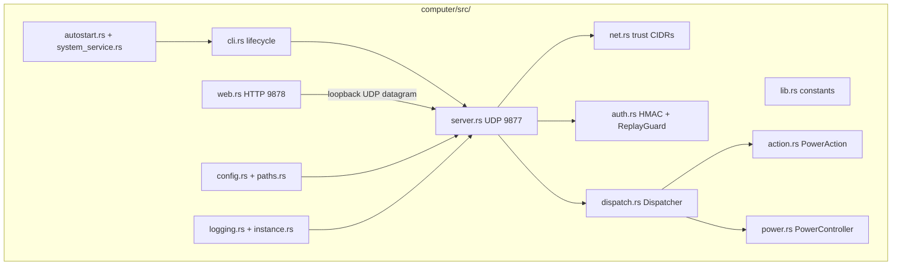
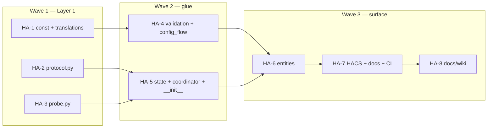

docs/wiki / 4. Repository Structure &amp; File Ownership Map

# 4. Repository Structure & File Ownership Map

Relevant source files

- [`computer/src/lib.rs`](../../computer/src/lib.rs#L1-L35)
- [`computer/src/server.rs`](../../computer/src/server.rs#L54-L385)
- [`wakeonlanhomephone/app/src/main/java/com/example/wakeonlanhomephone/PcActionDispatcher.kt`](../../wakeonlanhomephone/app/src/main/java/com/example/wakeonlanhomephone/PcActionDispatcher.kt#L22-L175)
- [`wakeonwanremotephone/app/src/main/java/com/example/wakeonwanremotephone/RemoteNetworkUtil.kt`](../../wakeonwanremotephone/app/src/main/java/com/example/wakeonwanremotephone/RemoteNetworkUtil.kt#L15-L216)
- [`custom_components/pc_onoff/const.py`](../../custom_components/pc_onoff/const.py#L1-L36)
- [`custom_components/pc_onoff/coordinator.py`](../../custom_components/pc_onoff/coordinator.py#L143-L361)
- [`tests/homeassistant/test_entities.py`](../../tests/homeassistant/test_entities.py#L1-L538)
- [`hacs.json`](../../hacs.json#L1-L5)
- [`docs/home-assistant.md`](../home-assistant.md#L1-L477)
- [`.github/workflows/ci.yml`](../../.github/workflows/ci.yml#L1-L181)

## 4.1 Target PC Daemon (computer/src/)

| File | Lines | Responsibility | Key symbols |
| :--- | :--- | :--- | :--- |
| `lib.rs` | 1-83 | Module graph and constants | `APP_NAME`, `DEFAULT_UDP_PORT = 9877`, `MAX_COMMAND_BYTES = 1024` |
| `main.rs` | 1-9 | Process entry | Windows console attach; `cli::run` |
| `cli.rs` | 27-120, 285-420 | CLI, lifecycle, `--status`, `--log`, `--stop`, `--web-ui`, `--service` | `CliCommand`, `run` |
| `action.rs` | 12-110 | Fault-tolerant action parser | `PowerAction`, `ALL`, `keyword`, `label`, `parse` |
| `power.rs` | 34-56, 143-268 | OS power seam | `PowerController`, `SystemPower`, Linux/macOS candidates |
| `dispatch.rs` | 15-70 | Parse → execute → structured error | `Dispatcher
`, `DispatchError` |
| `auth.rs` | 93-359 | HMAC envelope, ReplayGuard, pre-start cutoff | `sign`, `verify_since`, `ReplayGuard`, `AuthError` |
| `crypto.rs` | 1-260 | SHA-256, HMAC-SHA256, hex, constant-time compare | FIPS/RFC 4231 vectors |
| `net.rs` | 9-37 | Trusted-source classification | `is_trusted_source` |
| `server.rs` | 54-385 | UDP 9877 transport adapter | `serve`, `receive_loop`, `authenticate_datagram` |
| `config.rs` | 25-205 | `config.ini` parse/save, secret generation | `AppConfig`, `ensure_secret` |
| `paths.rs` | 23-140 | Config/log/lock path resolution | `PC_ONOFF_DATA_DIR`, platform data dirs |
| `logging.rs` | 18-160 | 5 MB rotating log | `Logger`, `DEFAULT_MAX_LOG_BYTES` |
| `instance.rs` | 74-140 | Single-instance mutex/lockfile | `SingleInstance`, `request_stop` |
| `autostart.rs` | 32-70 | Per-user autostart | HKCU Run, systemd user/XDG, LaunchAgent |
| `system_service.rs` | 11-120 | Linux system-wide service | `--install-system`, `/etc/systemd/system/pc_onoff.service` |
| `platform.rs` | 1-160 | OS subprocess/console nuances | Console attach, command spawning |
| `web.rs` | 101-180, 405-600 | Loopback dashboard | `serve`, `/api/status`, `/api/log`, `/api/action` |
| `web/app.html` | 1-1115 | Embedded Frost dashboard | Light/dark, reduced motion, no external assets |

Sources: [computer/src/lib.rs:1-35](../../computer/src/lib.rs#L1-L35), [computer/src/action.rs:12-110](../../computer/src/action.rs#L12-L110), [computer/src/server.rs:54-385](../../computer/src/server.rs#L54-L385), [computer/src/web.rs:405-600](../../computer/src/web.rs#L405-L600), [computer/src/paths.rs:23-140](../../computer/src/paths.rs#L23-L140)

## 4.2 Home Phone Gateway (wakeonlanhomephone/)

| File | Lines | Responsibility |
| :--- | :--- | :--- |
| `PcActionDispatcher.kt` | 22-175 | Deep module: parse, validate, UDP 9, UDP 9877, `PcActionResult` |
| `WolUtil.kt` | 8-42 | 102-byte magic packet sender |
| `CommandAuth.kt` | 36-280 | HMAC, trust CIDRs, `ReplayGuard`, wire errors |
| `WolListenerService.kt` | 81-300 | TCP 9876 listener, bounded line, auth, result line |
| `MqttWolService.kt` | 232-458 | MQTT connect/subscribe, retained filter, dispatch |
| `MqttSupport.kt` | 99-150 | Endpoint parse, topic filters, reconnect policy |
| `MqttConfigManager.kt` | 46-80 | Broker config, helper secret, shared PC secret |
| `DeviceProfileManager.kt` | 15-130 | Target PCs `(name, mac, ip, pcSecret)` |
| `DeviceManager.kt` | 1-102 | MQTT device registry |
| `AppGlobalState.kt` | 1-53 | MQTT connection StateFlow |
| `AppLogger.kt` | 1-34 | In-memory UI log ring |
| `AppLocale.kt` | 1-64 | System / en / zh-TW locale |
| `BootReceiver.kt` | 1-36 | MQTT auto-connect after boot |
| `VoiceWakeActivity.kt` | 1-40 | Invisible shortcut entry; dispatch `WAKE` |
| `WakePcWidgetProvider.kt` | 1-193 | WoL widget; per-install token |
| `ServerScreen.kt` | 1-1124 | Target list, power tiles, server status |
| `ConnectionsScreen.kt` | 1-509 | MQTT broker/device UI |
| `AddDeviceScreen.kt` | 1-395 | Add/edit target form |
| `MainActivity.kt` | 293-330 | Direct UI dispatch and navigation |
| `UpdateManager.kt` | 1-235 | GitHub release updater |
| `GithubRelease.kt` | 1-17 | Release JSON models |
| `ui/components/GlassComponents.kt` | 1-500 | Frost panels, nav, wake button, sheet |
| `ui/theme/{Color,Theme,ThemeMode,Type}.kt` | 1-200 each | Frost palette, theme, appearance, type |
| `app/src/main/res/xml/shortcuts.xml` | 1-14 | `wake_pc_shortcut` → `VoiceWakeActivity` |
| `app/src/main/res/xml/backup_rules.xml` | 1-12 | Secret SharedPreferences excluded |
| `app/src/main/res/xml/data_extraction_rules.xml` | 1-18 | Android 12+ transfer exclusions |

| Test / build file | Lines | Covers |
| :--- | :--- | :--- |
| `app/src/test/.../PcActionDispatcherTest.kt` | 1-267 | Command formats, MAC/IP checks, secret paths |
| `app/src/test/.../CommandAuthTest.kt` | 1-222 | Fixed vector, trust CIDRs, replay |
| `app/src/test/.../MqttSupportTest.kt` | 1-135 | Endpoint/topic/reconnect rules |
| `app/src/test/.../UpdateManagerTest.kt` | 1-41 | Release parsing |
| `app/src/androidTest/.../ConfirmPowerDialogTest.kt` | 1-37 | Confirm sheet UI |
| `app/build.gradle.kts` | 1-60 | SDK 36 / min 24, signing |

Sources: [wakeonlanhomephone/app/src/main/java/com/example/wakeonlanhomephone/PcActionDispatcher.kt:22-175](../../wakeonlanhomephone/app/src/main/java/com/example/wakeonlanhomephone/PcActionDispatcher.kt#L22-L175), [wakeonlanhomephone/app/src/main/java/com/example/wakeonlanhomephone/WolListenerService.kt:81-300](../../wakeonlanhomephone/app/src/main/java/com/example/wakeonlanhomephone/WolListenerService.kt#L81-L300), [wakeonlanhomephone/app/src/main/java/com/example/wakeonlanhomephone/MqttWolService.kt:232-458](../../wakeonlanhomephone/app/src/main/java/com/example/wakeonlanhomephone/MqttWolService.kt#L232-L458), [wakeonlanhomephone/app/src/main/res/xml/shortcuts.xml:1-14](../../wakeonlanhomephone/app/src/main/res/xml/shortcuts.xml#L1-L14)

## 4.3 Remote Phone Controller (wakeonwanremotephone/)

| File | Lines | Responsibility |
| :--- | :--- | :--- |
| `MainActivity.kt` | 212-245 | Single-screen UI, mode routing, `sendCommand` |
| `RemoteNetworkUtil.kt` | 15-216 | TCP relay, direct UDP 9877, local UDP 9, error prefixes |
| `DeviceProfileManager.kt` | 1-130 | Multi-PC profiles + active selection |
| `SecuritySettings.kt` | 18-38 | Helper secret + shared PC secret |
| `SecuritySettingsDialog.kt` | 1-312 | Secret entry shield |
| `RemoteWakeWidgetProvider.kt` | 25-75 | 1-tap wake; per-install token |
| `CommandAuth.kt` | 36-267 | Duplicate HMAC/trust implementation |
| `AppLocale.kt` | 1-50 | Locale preference |
| `UpdateManager.kt` | 1-236 | GitHub release updater |
| `GithubRelease.kt` | 1-17 | Release JSON models |
| `ui/components/RemoteUiComponents.kt` | 1-600 | Frost cards, segmented control, power tiles, sheet |
| `ui/theme/{Color,Theme,ThemeMode,Type}.kt` | 1-200 each | Frost palette/type |
| `app/src/main/res/xml/backup_rules.xml` | 1-10 | Secret SharedPreferences excluded |
| `app/src/main/res/xml/data_extraction_rules.xml` | 1-16 | Android 12+ transfer exclusions |
| `app/release.keystore` | — | **Never delete**; release signing |

| Test file | Covers |
| :--- | :--- |
| `app/src/test/.../RemoteNetworkUtilTest.kt` | TCP/direct framing, MAC parsing, error prefixes |
| `app/src/test/.../CommandAuthTest.kt` | Fixed vector and trust parity |
| `app/src/test/.../UpdateManagerTest.kt` | Release parsing |
| `app/src/androidTest/.../ConfirmPowerDialogTest.kt` | Confirm sheet UI |

Sources: [wakeonwanremotephone/app/src/main/java/com/example/wakeonwanremotephone/RemoteNetworkUtil.kt:15-216](../../wakeonwanremotephone/app/src/main/java/com/example/wakeonwanremotephone/RemoteNetworkUtil.kt#L15-L216), [wakeonwanremotephone/app/src/main/java/com/example/wakeonwanremotephone/MainActivity.kt:212-245](../../wakeonwanremotephone/app/src/main/java/com/example/wakeonwanremotephone/MainActivity.kt#L212-L245), [wakeonwanremotephone/app/src/main/java/com/example/wakeonwanremotephone/SecuritySettings.kt:18-38](../../wakeonwanremotephone/app/src/main/java/com/example/wakeonwanremotephone/SecuritySettings.kt#L18-L38)

## 4.4 Home Assistant Custom Integration (custom_components/pc_onoff/)

| File | Layer | Lines | Responsibility |
| :--- | :--- | :--- | :--- |
| `const.py` | 1 | 1-36 | `DOMAIN`, `PLATFORMS`, 11 `CONF_*`, defaults, `OPTIMISTIC_HOLD_SECONDS` |
| `protocol.py` | 1 | 69-440 | MAC, magic packet, trust, HMAC, UDP |
| `probe.py` | 1 | 79-178 | `async_probe_host` ping/tcp/none |
| `state.py` | 1 | 38-130 | `OptimisticStateTracker` |
| `validation.py` | 1 | 143-275 | Pure config/options validation |
| `config_flow.py` | 2 | 221-305 | `PcOnOffConfigFlow`, `PcOnOffOptionsFlow` |
| `coordinator.py` | 2 | 143-361 | `PcTargetConfig`, `PcOnOffCoordinator` |
| `__init__.py` | 2 | 36-87 | Entry setup/unload, `runtime_data` |
| `switch.py` | 3 | 43-81 | `PcPowerSwitch` |
| `button.py` | 3 | 38-128 | `PcActionButton` × 6 |
| `binary_sensor.py` | 3 | 41-65 | `PcConnectivitySensor` |
| `manifest.json` | metadata | 1-12 | Domain/version/config_flow/requirements `[]` |
| `strings.json` | metadata | 1-123 | English source strings |
| `translations/en.json` | metadata | 1-123 | English key parity |
| `translations/zh-Hant.json` | metadata | 1-123 | Traditional Chinese key parity |

| Test file | Lines | Covers |
| :--- | :--- | :--- |
| `tests/homeassistant/__init__.py` | 1 | Package marker |
| `test_translations.py` | 1-294 | Key parity + manifest fields |
| `test_protocol.py` | 1-593 | Vector, MAC, magic packet, trust, UDP |
| `test_probe.py` | 1-269 | ping/tcp/none, refused, mocks |
| `test_config_flow.py` | 1-987 | User/options validation, immutability |
| `test_coordinator.py` | 1-937 | Fake-clock state machine + coordinator stubs |
| `test_entities.py` | 1-538 | Switch/button/sensor with `sys.modules` stubs |

Sources: [custom_components/pc_onoff/const.py:1-36](../../custom_components/pc_onoff/const.py#L1-L36), [custom_components/pc_onoff/protocol.py:69-440](../../custom_components/pc_onoff/protocol.py#L69-L440), [custom_components/pc_onoff/coordinator.py:143-361](../../custom_components/pc_onoff/coordinator.py#L143-L361), [custom_components/pc_onoff/switch.py:43-81](../../custom_components/pc_onoff/switch.py#L43-L81), [tests/homeassistant/test_entities.py:1-538](../../tests/homeassistant/test_entities.py#L1-L538)

## 4.5 Parallel Agent Slice Partitioning Guide

The HA work was partitioned into eight non-overlapping file slices. The same rule applies to any future change: one owner per file, contract files read-only unless your slice owns them, and cross-subsystem wire changes handled sequentially.

| Slice | Exclusive files | Depends on | Do not touch |
| :--- | :--- | :--- | :--- |
| HA-1 | `const.py`, `manifest.json`, `strings.json`, `translations/*`, `test_translations.py` | — | any protocol/entity file |
| HA-2 | `protocol.py`, `test_protocol.py` | `const.py` contract | `auth.rs`, Kotlin `CommandAuth.kt` without a wire change |
| HA-3 | `probe.py`, `test_probe.py` | `const.py` | `coordinator.py` |
| HA-4 | `validation.py`, `config_flow.py`, `test_config_flow.py` | `const.py`, `protocol.py` | `coordinator.py`, entities |
| HA-5 | `state.py`, `coordinator.py`, `__init__.py`, `test_coordinator.py` | Layer 1 contract | entity files |
| HA-6 | `switch.py`, `button.py`, `binary_sensor.py`, `test_entities.py` | coordinator API | protocol/state |
| HA-7 | `hacs.json`, `docs/home-assistant.md`, `README*`, `AGENTS.md`, CI | all layers | `docs/wiki/` |
| HA-8 | `docs/wiki/*` | all pages | any source file |

Why It Works This Way / 設計決策背景 (Decision Context)

<strong>File ownership is an architectural boundary, not bureaucracy.</strong> The HA layers share exact symbols (`PowerAction`, `PcTargetConfig`, `OptimisticStateTracker`) but are implemented by different workers. If two agents edit the same file, the contract drifts silently and the entity layer starts encoding protocol. The slice map keeps each behavior owned by one file and makes cross-subsystem changes deliberate.

<strong>Read-only contract files prevent accidental API churn.</strong> `const.py`, `protocol.py`, `state.py`, `validation.py` and `coordinator.py` are consumed by many slices. Treating them as read-only unless your slice owns them is what allows parallel work without merge conflicts or renamed symbols.

<strong>檔案所有權是架構邊界，不是官僚流程。</strong> HA 各層共用精確符號（`PowerAction`、`PcTargetConfig`、`OptimisticStateTracker`），但由不同 worker 實作。若兩個 agent 同時改同一個檔案，contract 會無聲漂移，entity 層就會開始偷渡 protocol 邏輯。Slice map 讓每個行為只有一個檔案負責，跨子系統變更必須刻意規劃。

<strong>唯讀 contract 檔案可避免意外 API 變動。</strong> `const.py`、`protocol.py`、`state.py`、`validation.py`、`coordinator.py` 被多個 slice 消費。除非你的 slice 擁有它，否則視為唯讀，才能平行工作而不產生合併衝突或符號改名。

Sources: [custom_components/pc_onoff/const.py:1-36](../../custom_components/pc_onoff/const.py#L1-L36), [custom_components/pc_onoff/protocol.py:69-440](../../custom_components/pc_onoff/protocol.py#L69-L440), [custom_components/pc_onoff/state.py:38-130](../../custom_components/pc_onoff/state.py#L38-L130), [custom_components/pc_onoff/coordinator.py:143-361](../../custom_components/pc_onoff/coordinator.py#L143-L361), [.github/workflows/ci.yml:1-181](../../.github/workflows/ci.yml#L1-L181)
