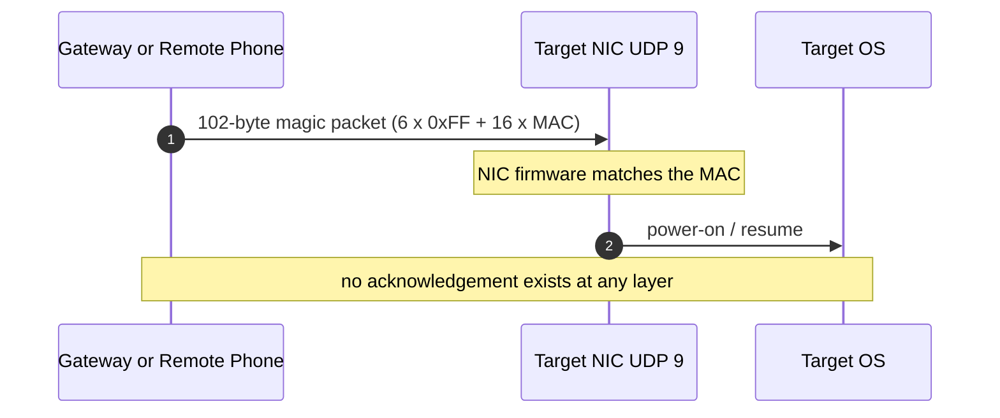
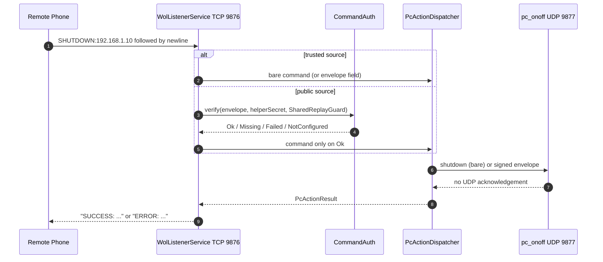
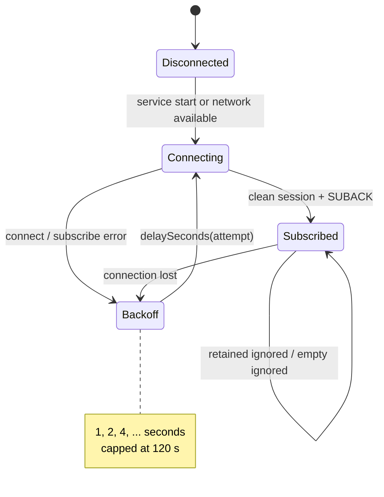
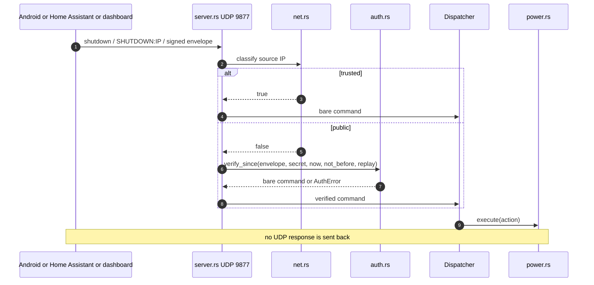
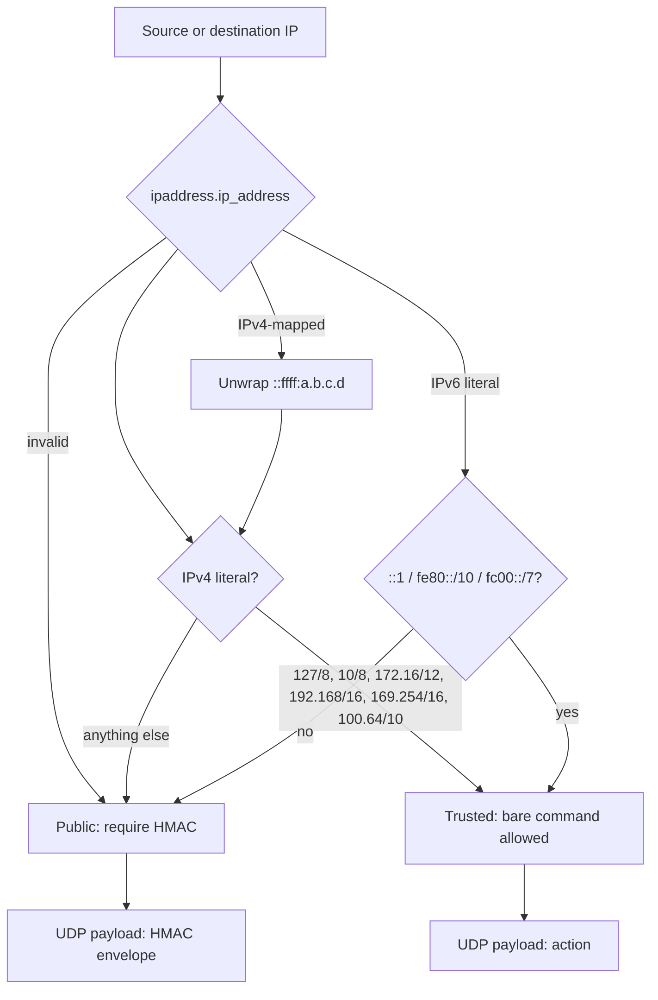
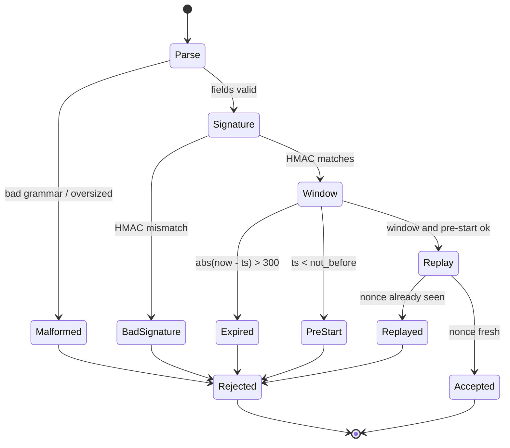

<div class="wiki-breadcrumb">docs/wiki / 3. Wire Protocols &amp; LAN/Tailscale-First Security</div>

# 3. Wire Protocols & LAN/Tailscale-First Security

<details class="relevant-sources">
<summary>Relevant source files</summary>

- [`computer/src/net.rs`](../../computer/src/net.rs#L9-L37)
- [`computer/src/auth.rs`](../../computer/src/auth.rs#L93-L359)
- [`computer/src/server.rs`](../../computer/src/server.rs#L54-L385)
- [`computer/src/action.rs`](../../computer/src/action.rs#L12-L93)
- [`computer/src/web.rs`](../../computer/src/web.rs#L405-L520)
- [`wakeonlanhomephone/app/src/main/java/com/example/wakeonlanhomephone/CommandAuth.kt`](../../wakeonlanhomephone/app/src/main/java/com/example/wakeonlanhomephone/CommandAuth.kt#L36-L280)
- [`wakeonlanhomephone/app/src/main/java/com/example/wakeonlanhomephone/WolListenerService.kt`](../../wakeonlanhomephone/app/src/main/java/com/example/wakeonlanhomephone/WolListenerService.kt#L81-L300)
- [`wakeonlanhomephone/app/src/main/java/com/example/wakeonlanhomephone/MqttWolService.kt`](../../wakeonlanhomephone/app/src/main/java/com/example/wakeonlanhomephone/MqttWolService.kt#L232-L458)
- [`custom_components/pc_onoff/protocol.py`](../../custom_components/pc_onoff/protocol.py#L69-L440)

</details>

## 3.1 Wake-on-LAN Magic Packet (UDP 9)

Wake-on-LAN is deliberately unauthenticated: the NIC firmware is the receiver, there is no session, and no acknowledgement exists. The security boundary is the LAN broadcast domain, not the packet.

| Offset | Length | Field | Rule |
| :--- | :--- | :--- | :--- |
| 0 | 6 | Sync stream | `0xFF` x 6 |
| 6 | 96 | MAC repetitions | Target 6-byte MAC x 16 |
| 102 | — | End | Exactly 102 bytes; no checksum, no trailer |

| Sender | Socket behavior | Default destination |
| :--- | :--- | :--- |
| Home Phone `WolUtil` | `DatagramSocket.broadcast = true` | `255.255.255.255:9` (or configured `defaultBroadcastIp`) |
| Remote Phone `sendLocalMagicPacket` | Broadcast socket | `255.255.255.255:9` |
| Home Assistant `send_magic_packet_sync` | `SO_BROADCAST` | `broadcast_ip:wol_port` (default `255.255.255.255:9`) |
| Rust daemon | Does not send WoL | NIC handles magic packets while the OS is off |



Sources: [wakeonlanhomephone/app/src/main/java/com/example/wakeonlanhomephone/WolUtil.kt:8-42](../../wakeonlanhomephone/app/src/main/java/com/example/wakeonlanhomephone/WolUtil.kt#L8-L42), [wakeonwanremotephone/app/src/main/java/com/example/wakeonwanremotephone/RemoteNetworkUtil.kt:128-154](../../wakeonwanremotephone/app/src/main/java/com/example/wakeonwanremotephone/RemoteNetworkUtil.kt#L128-L154), [custom_components/pc_onoff/protocol.py:190-207](../../custom_components/pc_onoff/protocol.py#L190-L207), [custom_components/pc_onoff/protocol.py:360-388](../../custom_components/pc_onoff/protocol.py#L360-L388)

## 3.2 Home Phone Relay Protocol (TCP 9876 & MQTT)

TCP 9876 is the only synchronous command channel in the system: one UTF-8 line in, one result line out. MQTT is a separate inbound adapter with a different trust boundary — the broker, not an HMAC verifier.

| TCP property | Value | Source |
| :--- | :--- | :--- |
| Listen port | `9876` (`LISTENING_PORT`) | [`WolListenerService.kt:81`](../../wakeonlanhomephone/app/src/main/java/com/example/wakeonlanhomephone/WolListenerService.kt#L81-L81) |
| Request framing | One line, CR or LF terminates; max 512 bytes | [`WolListenerService.kt:190-236`](../../wakeonlanhomephone/app/src/main/java/com/example/wakeonlanhomephone/WolListenerService.kt#L190-L236) |
| Response | `SUCCESS: <message>\n` or `ERROR: <reason>\n` | [`WolListenerService.kt:238-300`](../../wakeonlanhomephone/app/src/main/java/com/example/wakeonlanhomephone/WolListenerService.kt#L238-L300) |
| Client read cap | 1024 bytes, trailing CR dropped | [`RemoteNetworkUtil.kt:108-126`](../../wakeonwanremotephone/app/src/main/java/com/example/wakeonwanremotephone/RemoteNetworkUtil.kt#L108-L126) |
| Socket timeout | 5 s | [`WolListenerService.kt:83`](../../wakeonlanhomephone/app/src/main/java/com/example/wakeonlanhomephone/WolListenerService.kt#L83-L83) |
| Worker pool | 4 threads, queue 16 | [`WolListenerService.kt:55-60`](../../wakeonlanhomephone/app/src/main/java/com/example/wakeonlanhomephone/WolListenerService.kt#L55-L60) |

| Source class | Accepted request | Secret / check |
| :--- | :--- | :--- |
| Trusted LAN / link-local / ULA / Tailscale | Bare command **or** signed envelope; only the command field is extracted | None; signature is not checked |
| Public IPv4 / IPv6 | Signed envelope only | `helperSecret`; HMAC + ±300 s + replay |

| Failure | Exact response line |
| :--- | :--- |
| Missing, malformed, oversized, empty command | `ERROR: authentication required` |
| Bad signature, expired timestamp, replayed nonce | `ERROR: authentication failed` |
| Helper secret blank on a public connection | `ERROR: authentication not configured` |

| MQTT property | Value |
| :--- | :--- |
| Default command filter | `home/pc/wake` (`MqttConfigManager.DEFAULT_TOPIC`) |
| QoS / session | QoS 1; clean session `true`; re-subscribe after connect |
| Retained commands | **Ignored** — avoids replaying a shutdown on every reconnect |
| Empty payload | Ignored |
| Envelope handling | Command field extracted; HMAC is **not** verified |
| Reconnect | Exponential 1, 2, 4 … capped at 120 s |





Sources: [wakeonlanhomephone/app/src/main/java/com/example/wakeonlanhomephone/WolListenerService.kt:81-300](../../wakeonlanhomephone/app/src/main/java/com/example/wakeonlanhomephone/WolListenerService.kt#L81-L300), [wakeonlanhomephone/app/src/main/java/com/example/wakeonlanhomephone/CommandAuth.kt:90-180](../../wakeonlanhomephone/app/src/main/java/com/example/wakeonlanhomephone/CommandAuth.kt#L90-L180), [wakeonlanhomephone/app/src/main/java/com/example/wakeonlanhomephone/MqttWolService.kt:232-458](../../wakeonlanhomephone/app/src/main/java/com/example/wakeonlanhomephone/MqttWolService.kt#L232-L458), [wakeonlanhomephone/app/src/main/java/com/example/wakeonlanhomephone/MqttSupport.kt:134-150](../../wakeonlanhomephone/app/src/main/java/com/example/wakeonlanhomephone/MqttSupport.kt#L134-L150)

## 3.3 PC Daemon Control Protocol (UDP 9877 IPv4/IPv6)

The daemon receives a single UTF-8 datagram, authenticates the source, parses an action, and executes it. There is no response and no retry: "sent" only means the sender's socket accepted the datagram.

| Wire grammar | Example | Notes |
| :--- | :--- | :--- |
| `<action>` | `shutdown` | Bare command on a trusted source |
| `<action>:<ignored>` | `SHUTDOWN:192.168.1.10` | Legacy Android form; suffix ignored |
| `<action>,<ignored>` | `SLEEP,192.168.1.10` | Comma variant; suffix ignored |
| `<envelope>` | `sig=...` suffix on the standard envelope | Required for public sources |

| Keyword | Canonical action | Aliases |
| :--- | :--- | :--- |
| `shutdown` | Power off | `poweroff` |
| `reboot` | Restart | `restart` |
| `sleep` | Suspend to RAM | `suspend`, `standby` |
| `hibernate` | Suspend to disk | — |
| `lock` | Lock session/screen | — |

| Socket property | Behavior | Source |
| :--- | :--- | :--- |
| IPv4 bind | `0.0.0.0:<udp_port>` required; default 9877 | [`server.rs:54-118`](../../computer/src/server.rs#L54-L118) |
| IPv6 bind | `[::]:<udp_port>` best effort; `IPV6_V6ONLY=1` on Linux | [`server.rs:166-258`](../../computer/src/server.rs#L166-L258) |
| Max datagram | 1024 bytes (`MAX_COMMAND_BYTES`) | [`lib.rs:26-31`](../../computer/src/lib.rs#L26-L31) |
| Oversized datagram | Never a valid envelope; Windows `WSAEMSGSIZE` logged and skipped | [`server.rs:119-165`](../../computer/src/server.rs#L119-L165) |
| Acknowledgement | None | [`server.rs:360-385`](../../computer/src/server.rs#L360-L385) |



Sources: [computer/src/action.rs:12-93](../../computer/src/action.rs#L12-L93), [computer/src/server.rs:54-385](../../computer/src/server.rs#L54-L385), [computer/src/auth.rs:124-200](../../computer/src/auth.rs#L124-L200), [computer/src/power.rs:34-56](../../computer/src/power.rs#L34-L56), [computer/src/lib.rs:26-31](../../computer/src/lib.rs#L26-L31)

## 3.4 Trusted CIDR Classification

Trust is evaluated on the **source** address for inbound listeners (Home Phone TCP 9876, daemon UDP 9877) and on the **destination** address for outbound senders (Android apps, Home Assistant). The same table is implemented three times; changing it is a protocol change.

| IPv4 prefix | Trusted? | Notes |
| :--- | :--- | :--- |
| `127.0.0.0/8` | Yes | Loopback |
| `10.0.0.0/8` | Yes | RFC1918 |
| `172.16.0.0/12` | Yes | RFC1918 (`172.16.0.0`–`172.31.255.255`) |
| `192.168.0.0/16` | Yes | RFC1918 |
| `169.254.0.0/16` | Yes | Link-local |
| `100.64.0.0/10` | Yes | Tailscale / CGNAT |
| Everything else | **No** | Including `8.8.8.8`, `192.0.2.1`, `100.128.0.1` |

| IPv6 prefix / address | Trusted? | Notes |
| :--- | :--- | :--- |
| `::1` | Yes | Loopback |
| `fe80::/10` | Yes | Link-local |
| `fc00::/7` | Yes | Unique local, includes `fd7a:115c:a1e0::/48` |
| `fec0::/10` | **No** | Deprecated site-local; do not treat as RFC1918 |
| `::ffff:a.b.c.d` | Unwrapped | Classified by the IPv4 table |

| Implementation | Trap to avoid | Source |
| :--- | :--- | :--- |
| Python HA | Never use `ip_address(...).is_private`; it includes `192.0.2.0/24` and changes across versions | [`protocol.py:217-245`](../../custom_components/pc_onoff/protocol.py#L217-L245) |
| Rust | `is_private` + explicit `100.64/10` + `(segments[0] & 0xfe00) == 0xfc00` | [`net.rs:9-37`](../../computer/src/net.rs#L9-L37) |
| Kotlin | IPv4-only `isSiteLocalAddress`; avoid trusting `fec0::/10` | [`CommandAuth.kt:139-180`](../../wakeonlanhomephone/app/src/main/java/com/example/wakeonlanhomephone/CommandAuth.kt#L139-L180) |



<div class="decision-context">
<div class="decision-title">Why It Works This Way / 設計決策背景 <span>(Decision Context)</span></div>
<div class="lang-en">
<p><strong>Trust is a network fact, not a transport feature.</strong> TCP 9876, UDP 9877, IPv4 and IPv6 all use the same CIDR table. A packet from `192.168.1.20` or `fd7a:115c:a1e0::1` already crossed a private boundary; a packet from `8.8.8.8` did not. Tying the rule to the source/destination IP keeps the UX simple and prevents a new transport from accidentally bypassing the boundary.</p>
<p><strong>Public traffic is fail-closed by design.</strong> There is no "maybe signed" mode. If the destination is public and no secret exists, the Android/HA sender refuses locally; the daemon rejects public packets without a valid envelope. This is deliberately less convenient than a plaintext fallback, because a plaintext public power command is a remote shutdown primitive.</p>
</div>
<div class="lang-zh">
<p><strong>信任是網路事實，不是傳輸層特性。</strong> TCP 9876、UDP 9877、IPv4 與 IPv6 都共用同一張 CIDR 表。來自 `192.168.1.20` 或 `fd7a:115c:a1e0::1` 的封包已跨越私人邊界；來自 `8.8.8.8` 的封包則沒有。把規則綁在來源/目的 IP，可保持使用體驗簡單，也避免新增傳輸方式時意外繞過邊界。</p>
<p><strong>公網流量刻意採 fail-closed。</strong> 沒有「也許簽章」模式。若目的地位於公網且沒有密鑰，Android / HA 發送端會在本機拒絕；daemon 也會拒絕沒有有效 envelope 的公網封包。這比明文回退更不方便，但明文公網電源指令本質上就是一個遠端關機原語。</p>
</div>
</div>

Sources: [computer/src/net.rs:9-37](../../computer/src/net.rs#L9-L37), [wakeonlanhomephone/app/src/main/java/com/example/wakeonlanhomephone/CommandAuth.kt:139-180](../../wakeonlanhomephone/app/src/main/java/com/example/wakeonlanhomephone/CommandAuth.kt#L139-L180), [custom_components/pc_onoff/protocol.py:217-245](../../custom_components/pc_onoff/protocol.py#L217-L245)

## 3.5 HMAC-SHA256 v1 Envelope, ReplayGuard & Pre-Start Cutoff

```text
<command>|ts=<unix-seconds>|nonce=<16 lowercase hex>|sig=<64 lowercase hex>
```

| Field | Rule |
| :--- | :--- |
| `command` | Non-empty UTF-8; no leading/trailing whitespace, no pipe character, no control characters |
| `ts` | Unix seconds, decimal, non-negative |
| `nonce` | Exactly 16 lowercase hex (64 random bits) |
| `sig` | Exactly 64 lowercase hex (HMAC-SHA256) |
| Whole envelope | ≤ 512 UTF-8 bytes |
| Secret | Trimmed; blank is a hard error; HA rejects all control characters |

```text
sign_input = "<command>|ts=<ts>|nonce=<nonce>"
sig        = lowercase_hex(HMAC-SHA256(key=UTF8(trim(secret)), message=UTF8(sign_input)))
envelope   = sign_input + "|sig=" + sig
```

| Implementation | Check order |
| :--- | :--- |
| Rust daemon | blank secret → parse/length/hex → signature → ±300 s → pre-start → replay insert |
| Kotlin helper | blank secret (`NotConfigured`) → parse/length/hex → signature → ±300 s → replay insert |
| Python HA | signer only: secret/control chars → command → `ts >= 0` → nonce regex → HMAC → length |

| Replay property | Value |
| :--- | :--- |
| Timestamp window | ±300 s |
| Nonce TTL | 600 s |
| Capacity | 1024 entries |
| Expiry boundary | Entry valid at `expires_at == now` (inclusive) |
| Eviction | Oldest / closest-to-expiry when full; cache never grows |
| Pre-start cutoff | Rust rejects `ts < not_before` before inserting the nonce |

| Fixed cross-language vector | Value |
| :--- | :--- |
| Command | `SHUTDOWN:192.168.1.10` |
| Secret | `0123456789abcdef0123456789abcdef` |
| Timestamp | `1700000000` |
| Nonce | `0011223344556677` |
| Expected signature | `6582b1c23ef97498af3f91ade1a74ce60f335dae38a2aa51f403254505fbfbdc` |



Sources: [computer/src/auth.rs:93-200](../../computer/src/auth.rs#L93-L200), [computer/src/auth.rs:251-359](../../computer/src/auth.rs#L251-L359), [wakeonlanhomephone/app/src/main/java/com/example/wakeonlanhomephone/CommandAuth.kt:56-118](../../wakeonlanhomephone/app/src/main/java/com/example/wakeonlanhomephone/CommandAuth.kt#L56-L118), [custom_components/pc_onoff/protocol.py:247-318](../../custom_components/pc_onoff/protocol.py#L247-L318)

## 3.6 Local Dashboard (HTTP 9878) & Secret Hierarchy

The dashboard is a loopback-only foreground mode, not another network control surface. It reuses the real UDP/auth path by sending a datagram to `127.0.0.1:<udp_port>`.

| Endpoint | Method | Behavior |
| :--- | :--- | :--- |
| `/` | GET | Embedded Frost HTML (`include_str!("web/app.html")`) |
| `/api/status` | GET | JSON: version, running, pid, udp_port, local_ips, autostart, system service, paths, last 8 log lines |
| `/api/log?lines=N` | GET | JSON tail; `N` clamped 1..200, default 40 |
| `/api/action` | POST | JSON `{"action":"shutdown"}`; sends loopback UDP, signed if configured |

| Secret | Purpose | Where configured | Fallback |
| :--- | :--- | :--- | :--- |
| PC secret | Signs UDP 9877 commands; shared with `pc_onoff` | Per target profile on both apps; `pc_secret` in HA; `secret=` in `config.ini` | Android global Settings / shield |
| Helper secret | Guards public TCP 9876; signs relayed commands | Home Phone Settings → Security; Remote Phone shield | None; blank fails public TCP |
| MQTT credentials | Broker authentication | Home Phone MQTT settings | None |

| Secret format / storage rule | Value |
| :--- | :--- |
| Daemon generated secret | 32 lowercase hex (128-bit) |
| Android generated secret | 32 lowercase hex |
| HA secret validation | Any trimmed non-empty value without control characters |
| Rust config rejection | CR, LF, NUL |
| Android backup exclusions | Home Phone: `mqtt_config.xml`, `HomePhoneDevicePrefs.xml`, `widget_security.xml`; Remote: `security_settings.xml`, `RemoteControlPrefs.xml` |

| Symptom | Meaning | Fix |
| :--- | :--- | :--- |
| `ERROR: authentication required` | Missing/malformed/oversized envelope or empty line | Send a full envelope |
| `ERROR: authentication failed` | Bad signature, clock skew > ±300 s, or replay | Match secrets; enable NTP; use a fresh nonce |
| `ERROR: authentication not configured` | Helper secret blank on a public connection | Configure it or use LAN/Tailscale |
| `PC secret is required for a public IP` | Public destination without a PC secret | Add per-profile / HA secret |
| Daemon logs `not_configured` | Public datagram arrived with blank daemon secret | `pc_onoff --status`, configure, restart |
| Daemon logs `pre_start_replay` | Envelope predates daemon startup | Send a fresh command |
| Command sent but PC does nothing | UDP has no ack; OS call may have failed | Read `pc_onoff.log` / `--log` |

Sources: [computer/src/web.rs:405-520](../../computer/src/web.rs#L405-L520), [computer/src/config.rs:25-120](../../computer/src/config.rs#L25-L120), [computer/src/config.rs:186-205](../../computer/src/config.rs#L186-L205), [wakeonwanremotephone/app/src/main/java/com/example/wakeonwanremotephone/SecuritySettings.kt:18-38](../../wakeonwanremotephone/app/src/main/java/com/example/wakeonwanremotephone/SecuritySettings.kt#L18-L38), [wakeonlanhomephone/app/src/main/res/xml/backup_rules.xml:1-12](../../wakeonlanhomephone/app/src/main/res/xml/backup_rules.xml#L1-L12), [wakeonwanremotephone/app/src/main/res/xml/backup_rules.xml:1-10](../../wakeonwanremotephone/app/src/main/res/xml/backup_rules.xml#L1-L10)
